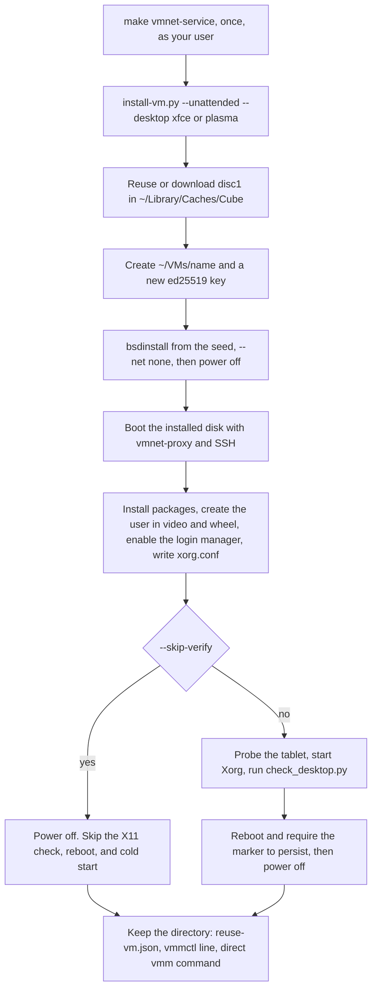

# FreeBSD desktop verification

Install a desktop VM with `scripts/install-vm.py`:

```sh
python3 -B scripts/install-vm.py --version 14.4 --unattended --desktop xfce --name work
python3 -B scripts/install-vm.py --version 15.1 --unattended --desktop plasma --name plasma
```

Start the vmnet service once with `make vmnet-service`. The installer then
uses `vmnet-proxy` as your user. Add `--sudo` to run `check_install.py` as
root with in-process vmnet. Direct `check_install.py --net bridge:en0` is the
in-process bridge on that Ethernet interface; it also runs as root, and the
guest takes a LAN address. The saved config and the printed `vmmctl` start
line follow that choice. The same run prints a direct `vmm` command with the
binary, kernel, disk, memory, CPUs, network mode, SSH port, and VNC display
filled in. Add `--skip-verify` to write the packages, login account, and Xorg
configuration, then skip the X11 input check, reboot, and cold-start check.
The full suite selects the same modes with `--suite full` as your user, or,
started with `sudo python3`, `--sudo --keep-root` and `--bridge en0 --keep-root`.
See [verification.md](verification.md).

`--version 15` selects 15.1. FreeBSD 15.0 can be installed interactively; its
scripted installer cannot use the packages on disc1. This runbook is the
regression and repair path. It validates the VNC display and USB HID path with
a real FreeBSD X11 session. The checker creates a new installed disk because
package installation and Xorg configuration modify the guest. Keep its artifacts
to reuse that disk as a VM later.



`--sudo` replaces vmnet-proxy with in-process vmnet for the boot that installs
packages. The shared install, reboot, and ZFS checks are drawn in
[install-regression.md](install-regression.md). The suite that calls this
script with the smaller twm desktop is drawn in
[verification.md](verification.md).

## Prerequisites

- Apple Silicon macOS and the signed VMM binary.
- A retained UFS result from `scripts/check_install.py --keep`. Its artifact
  directory contains `installed.img`, `boot/kernel/kernel`, and `id_ed25519`.
- Guest network access through vmnet.

The automated regression creates a disposable UFS installation, installs the
desktop packages, starts Xorg with SCFB, runs the input/update verifier, reboots,
and powers off cleanly:

```sh
python3 scripts/check_install.py /tmp/vmm-gui-fix/debug/vmm \
  --iso FreeBSD-14.4-RELEASE-arm64-aarch64-disc1.iso \
  --desktop --keep
```

For an unattended **XFCE** installation on a new UFS disk, select
the desktop environment instead of the default `twm` test session:

```sh
mkdir -p "$HOME/VMs"
python3 -B scripts/check_install.py target/debug/cube \
  --iso FreeBSD-14.4-RELEASE-arm64-aarch64-disc1.iso \
  --desktop-environment xfce --desktop-timeout 2400 \
  --artifacts "$HOME/VMs" --keep
```

For an unattended **Plasma 6** installation, use the dedicated wrapper. It
creates a fresh UFS disk, installs the minimal `plasma6-plasma` package with
Konsole and SDDM, configures Xorg/scfb and the VMM USB tablet, verifies the
desktop across a reboot, and retains a reusable VM configuration:

```sh
mkdir -p "$HOME/VMs"
./scripts/unattended-plasma-install.sh \
  --iso FreeBSD-14.4-RELEASE-arm64-aarch64-disc1.iso \
  --artifacts "$HOME/VMs"
```

The wrapper defaults to a 20 GiB sparse disk, 4096 MiB RAM, four CPUs, a
1280x800 display, and a one-hour desktop setup timeout. Pass the regular
`check_install.py` options after `--iso` to override those defaults. Use
`--desktop-user`, `--desktop-password-file`, and `--root-password-file` to set
credentials. Plasma runs as an X11 session because this VMM exposes an SCFB
framebuffer without accelerated graphics. The resulting artifact directory
contains `reuse-vm.json`, `desktop-login.txt`, and `root-login.txt` and is used
the same way as the XFCE artifact described below.

The XFCE login defaults to username `vmm` and an 8-character generated password. To choose
your own credentials for a **new** install, add `--desktop-user NAME` and
`--desktop-password-file PATH`. The file must contain one nonempty UTF-8 line;
keep it private (for example, mode 0600). The password is read from the file
and sent to FreeBSD's `pw` command over SSH standard input, rather than placed
on the command line:

```sh
python3 -B scripts/check_install.py target/debug/cube \
  --iso FreeBSD-14.4-RELEASE-arm64-aarch64-disc1.iso \
  --desktop-environment xfce --desktop-user cubeuser \
  --desktop-password-file "$HOME/VMs/xfce-password.txt" \
  --root-password-file "$HOME/VMs/xfce-password.txt" \
  --desktop-timeout 2400 --artifacts "$HOME/VMs" --keep
```

The desktop password can differ from the root password. `desktop-login.txt` in
the retained artifact directory records the selected username and password;
`root-login.txt` records
the separate root password. Read either with `cat`. To choose root's
password for a new install as well, pass `--root-password-file PATH` (the same
file as the desktop password file if you want matching passwords). These files
each contain one nonempty UTF-8 line and should have mode 0600.
The desktop options affect new installations, not an existing `installed.img`.

`unattended-install.sh` defaults to `root:root`, but this regression installer
passes a generated root password to the same `create-seed.sh` script unless
`--root-password-file` is supplied. For an already installed VM, boot it with
`--ssh-port 2222` and set root to the password recorded in `desktop-login.txt`:

```sh
INSTALL="$HOME/VMs/vmm-install-uwtcnyim"  # replace with your artifact path
bash scripts/set_freebsd_root_password.sh "$INSTALL"
```

The helper authenticates with the artifact's SSH key and passes the password
to FreeBSD's `pw` over SSH standard input. It then updates `root-login.txt`.
Pass a different password file as its second argument to choose another root
password. The guest must be running and its SSH forward must be reachable; the
third argument overrides port 2222. Use the desktop account for graphical login
and root for terminal/SSH administration.

The XFCE path installs XFCE, Xorg/scfb, D-Bus, LightDM and its GTK greeter,
plus DejaVu fonts and Adwaita icons so the login screen has readable labels.
It creates a `vmm` desktop user, starts an XFCE session for the same VNC/XI2
input check, enables D-Bus and LightDM for subsequent boots, then requires
the USB tablet, LightDM, and Xorg after the guest reboots. The retained
`installed.img` contains those packages, account, and settings; the private
artifact directory holds the login passwords (mode 0600).

### Reuse the XFCE VM

The checker shuts the guest down after verification; it does not leave an
instance running. With `--keep`, it writes `reuse-vm.json` beside `installed.img`,
`boot/kernel/kernel`, `id_ed25519`, `desktop-login.txt`, and `root-login.txt`.
The output prints the artifact directory and config path. Keep the whole directory in a durable
location: the config's paths to the disk, kernel, and SSH key are relative to
that directory. To start the same installed VM later, substitute the printed
artifact path below:

```sh
INSTALL=/path/to/vmm-install-XXXXXX
python3 -B scripts/vmmctl.py start "$INSTALL/reuse-vm.json"
python3 -B scripts/vmmctl.py status "$INSTALL/reuse-vm.json"
# Connect a VNC viewer to 127.0.0.1:5901; log in as vmm.
cat "$INSTALL/desktop-login.txt"
python3 -B scripts/vmmctl.py shutdown "$INSTALL/reuse-vm.json"
# Run start again whenever you want to use this same disk.
```

To run the same XFCE VM **in the foreground**, as with
`unattended-install.sh`, stop any `vmmctl` instance using this disk first.
Then run from the repository root:

```sh
INSTALL=/path/to/vmm-install-XXXXXX  # replace with the printed artifact path
./target/debug/cube \
  --freebsd "$INSTALL/boot/kernel/kernel" --multiuser \
  --disk "$INSTALL/installed.img" \
  --ram 2048 --cpus 2 \
  --net vmnet-proxy --ssh-port 2222 \
  --vnc 127.0.0.1:5901 --display 1024x768 \
  --serial-log "$INSTALL/foreground.console.log"
```

Connect a VNC viewer to `127.0.0.1:5901`, log in as `vmm`, and read the
password with `cat "$INSTALL/desktop-login.txt"`. For a clean poweroff,
run this in another terminal (set `INSTALL` there too):

```sh
ssh -F /dev/null -i "$INSTALL/id_ed25519" -p 2222 \
  -o IdentitiesOnly=yes -o StrictHostKeyChecking=accept-new \
  root@127.0.0.1 'shutdown -p now'
```

To open the same installed VM in a **native Cocoa/Metal window**, stop the VNC
instance first and replace `--vnc` in the foreground command with `--gui native`:

```sh
INSTALL=/path/to/vmm-install-XXXXXX
CARGO_TARGET_DIR=/tmp/vmm-gui-fix cargo build --locked
codesign --entitlements entitlements.plist --force -s - /tmp/vmm-gui-fix/debug/vmm
/tmp/vmm-gui-fix/debug/vmm \
  --freebsd "$INSTALL/boot/kernel/kernel" --multiuser \
  --disk "$INSTALL/installed.img" --ram 2048 --cpus 2 \
  --net vmnet-proxy --ssh-port 2222 \
  --gui native --display 1024x768 \
  --serial-log "$INSTALL/native.console.log"
```

The window presents the existing fixed-resolution framebuffer with aspect-ratio
letterboxing and sends mouse, wheel, and physical keyboard events through the
guest USB HID devices. Closing it stops the VM process; shut down FreeBSD from
inside the guest or over SSH first when you want a clean guest poweroff. The
current key mapping uses a US physical keyboard layout, and a guest reboot
restarts the process and reopens the window. Native mode cannot be combined with
`--vnc`; use VNC for remote access and automated input checks.
On Retina screens, the native view uses the Metal drawable's physical pixels,
chooses the largest whole-pixel zoom that fits, and samples guest pixels without
interpolation. Without `--retina`, `--display 1024x768` enlarges each guest
pixel to roughly 2×2 physical pixels. Text is larger, but its glyphs can look
coarse because FreeBSD still renders them at 1024×768.

For an opt-in higher-resolution guest framebuffer, add `--retina` to the native
command. With `--display 1024x768 --retina`, the window starts at 1024×768
macOS points while FreeBSD sees a 2048×1536 framebuffer. On a 2× Retina screen
at that window size, each guest pixel maps to one display pixel. `--retina`
requires `--gui native`; it does not change VNC. XFCE and LightDM may initially
show smaller controls and text because their DPI settings remain unchanged.
Configure guest font/UI scaling to 200% if you want the same apparent size as
the default mode. The default native mode keeps the guest at 1024×768 and
scales each pixel sharply to 2×2 screen pixels.

Older XFCE artifacts may have an unusable greeter with empty-square text and
no mouse. They lack an explicit font set and the boot-time `vmm_hid` service.
While the guest is running with `--ssh-port 2222`, repair that installed disk
from the repository root:

```sh
bash scripts/repair_freebsd_desktop.sh "$INSTALL"
```

The repair installs fonts and icons, selects a readable LightDM GTK theme,
enables FreeBSD's USB HID/evdev path, and reprobes the tablet by its USB
descriptor rather than its changing `ugen` number. It restarts LightDM, which
ends the current greeter/session; reconnect VNC and log in as `vmm`. New XFCE
installs configure the same greeter assets and boot-time tablet service
automatically. If the current X11 session does not pick up the tablet, shut
down and boot the VM again.
The in-place repair was confirmed on the 2026-09-23 FreeBSD XFCE guest: the
greeter text and mouse worked after restarting LightDM. Persistence across a
subsequent guest reboot still needs a live check.

The config uses SSH forwarding on port 2222 for `vmmctl shutdown`, and the
installed disk remains writable across later starts. Override occupied ports
with `--ssh-port` and `--vnc` on `start` (and update the shutdown port in the
JSON if SSH changes). The binary path in the config is absolute; edit it if
the checkout moves. Unlike the regression's temporary process, `vmmctl` keeps
the guest running until it is shut down or stopped. See [VM management](vm-management.md)
for stop commands. The regression checks that the tablet attaches after reboot;
a full XFCE login and pointer-input replay on a later start still need an
end-to-end run.

Package installation requires guest Internet access and may take substantially
longer than the default `twm` check. The user completed a privileged XFCE
installation and confirmed the repaired greeter text and mouse. Retain and
inspect artifacts if a later run fails. The display manager presents a login
screen after reboot; the script does not configure automatic login.
[FreeBSD's desktop handbook](https://docs.freebsd.org/en/books/handbook/desktop/)
documents the `xfce` package, D-Bus, and LightDM setup.

Success includes the three desktop `PASS` lines documented below. The retained
artifact directory contains `desktop-results/display-metrics.json`, the XI2 event
and device logs, `desktop-check.log`, the VMM logs, and copies of the Xorg logs.

The 2026-09-22 FreeBSD 14.4 run passed all three desktop checks and the full
install → boot → reboot regression. At 1024×768, 32 framebuffer updates
averaged 38.4 updates/s and 14.0 MiB/s of raw pixel payload. The retained
artifacts are `/private/tmp/vmm-install-w_xfxah8`. The two VNC session records
report 96.0 MiB of framebuffer reads in 2.6 ms, 90.0 MiB of changed-row
comparisons in 3.6 ms, and 11.7 MiB sent in 291.0 ms. The send time was the
largest measured server cost in this run. `guest-hid.log` confirms `hms0`
attached with five buttons and X/Y/wheel axes.
The default `twm` desktop checks run before reboot; its post-reboot phase
verifies SSH and the persistent guest marker, not a restored X11 session or
returning HID input. The XFCE variant checks tablet attachment, LightDM, and
Xorg after reboot, but does not log in to XFCE or replay the HID test there.
The update check validates protocol framing and event delivery, not the visual
contents of a captured frame.

The remaining commands describe the equivalent manual workflow for diagnosis.
Use the printed artifact directory as `$INSTALL`. Start its installed system
with a configurable 1024×768 framebuffer:

```sh
/tmp/vmm-gui-fix/debug/vmm \
  --freebsd "$INSTALL/boot/kernel/kernel" --multiuser \
  --disk "$INSTALL/installed.img" --ram 2048 --cpus 2 \
  --net vmnet-proxy --ssh-port 2222 \
  --vnc 127.0.0.1:5901 --display 1024x768 \
  --serial-log "$INSTALL/desktop-vmm.log"
```

In another terminal, install the documented SCFB X11 stack:

```sh
SSH="ssh -F /dev/null -i $INSTALL/id_ed25519 -p 2222 \
  -o IdentitiesOnly=yes -o StrictHostKeyChecking=accept-new \
  -o UserKnownHostsFile=$INSTALL/desktop-known-hosts root@127.0.0.1"
$SSH 'sysctl hw.usb.usbhid.enable=1 kern.evdev.rcpt_mask=6 && \
  (kldload hms 2>/dev/null || true) && \
  usbconfig dump_device_desc'
```

FreeBSD 14.4 defaults to the legacy USB HID drivers. This VMM boots the UFS
kernel directly, so it does not read `/boot/loader.conf`. Enable `usbhid` at
runtime, then reset the device whose descriptor has `iProduct` equal to
`VMM USB Tablet` and `iSerialNumber` equal to `tablet0`. Use its `ugenN.N`
identifier printed above. The summary names come from a USB ID database and
can label both the keyboard and tablet as `QEMU Tablet`.

```sh
$SSH 'usbconfig -d ugen0.3 reset; sleep 2; dmesg | grep -E "usbhid|hms"'
```

Replace `ugen0.3` with the matching device identifier. The `hms` driver must
attach to expose the tablet's absolute axes through evdev. Then install the
desktop packages:

```sh
$SSH 'env ASSUME_ALWAYS_YES=yes pkg bootstrap && \
  pkg install -y xorg-minimal xf86-video-scfb xf86-input-libinput \
    twm xterm xinput xdpyinfo xdotool && \
  sysctl kern.evdev.rcpt_mask=6 && \
  mkdir -p /usr/local/etc/X11/xorg.conf.d && \
  printf "%s\n" "Section \"Device\"" "  Identifier \"Card0\"" \
    "  Driver \"scfb\"" "EndSection" \
    >/usr/local/etc/X11/xorg.conf.d/20-scfb.conf'
```

Start Xorg, the window manager, and one moving/resizable client:

```sh
$SSH 'pkill Xorg 2>/dev/null || true; \
  daemon -f -p /var/run/Xorg-vmm.pid -o /var/log/Xorg-vmm.log \
    /usr/local/bin/Xorg :0 -ac -noreset vt9'
$SSH 'until env DISPLAY=:0 xdpyinfo >/dev/null 2>&1; do sleep 1; done; \
  daemon -f -p /var/run/twm-vmm.pid -o /var/log/twm-vmm.log \
    /usr/bin/env DISPLAY=:0 /usr/local/bin/twm; \
  daemon -f -p /var/run/xterm-vmm.pid -o /var/log/xterm-vmm.log \
    /usr/bin/env DISPLAY=:0 /usr/local/bin/xterm -geometry 90x28+80+80'
```

Run the verifier from the host:

```sh
python3 scripts/check_desktop.py \
  --vnc 127.0.0.1:5901 --ssh-port 2222 \
  --identity "$INSTALL/id_ed25519" \
  --artifacts "$INSTALL/desktop-results"
```

The check queries pointer coordinates with `xdotool getmouselocation --shell`
after VNC moves to each framebuffer corner. This avoids depending on root-window
Motion delivery when a desktop or panel window receives the event. It records
the requested and observed positions in `pointer-positions.jsonl`, and requires
each corner within one pixel per axis, inside the framebuffer. This accommodates
the observed Plasma pointer position `(1, 1)` after a VNC move to `(0, 0)`;
larger deviations still fail. Existing guests need `pkg install -y xdotool`
before running the updated checker.

The check also uses `xinput --test-xi2 --root` to observe primary-button press/release, wheel
directions, keyboard press/release, and synthesized releases after disconnecting
with Control and the primary button held. It reconnects, requests full and
incremental frames, and writes client timing and payload measurements to
`display-metrics.json`, including when an input assertion fails. The VMM log adds
server-side framebuffer-read, changed-row scan, send time, and byte totals for
every VNC session.

Record the script's `PASS` lines and retain `desktop-results`, `desktop-vmm.log`,
`guest-hid.log`, `Xorg.0.log`, and `/var/log/Xorg-vmm.log` when closing the
roadmap criteria.
Stop the guest with `shutdown -p now`; Ctrl-] remains available as a host stop.

## Virtio-gpu decision

FreeBSD 14.4 contains `virtio_gpu`, introduced in FreeBSD 14.0, and ARM64
GENERIC includes it through `std.virt`. The driver creates a 2D `vt(4)`
framebuffer; it does not provide a DRM/VirGL accelerated desktop. The
ArmVirtQemu EDK2 build includes `VirtioGpuDxe`, so a future VMM device can also
provide GOP output before the kernel starts.

The decision for this milestone is **defer**. Implementing the control queue,
guest-backed 2D resources, scanout and cursor queue is feasible, but it adds no
known compatibility requirement for the SCFB desktop and no 3D acceleration.
Keep simple-framebuffer as the supported path, collect the measurements above,
and reconsider virtio-gpu if changed-row scanning or fixed boot-time geometry
becomes the limiting behavior.

Sources: [FreeBSD virtio_gpu(4) in 14.4](https://cgit.freebsd.org/src/tree/share/man/man4/virtio_gpu.4?h=releng/14.4),
[FreeBSD ARM64 std.virt in 14.4](https://cgit.freebsd.org/src/tree/sys/arm64/conf/std.virt?h=releng/14.4),
[FreeBSD X11 handbook](https://docs.freebsd.org/en/books/handbook/x11/), and
[EDK2 ArmVirtQemu configuration](https://github.com/tianocore/edk2/blob/edk2-stable202408/ArmVirtPkg/ArmVirtQemu.dsc).
