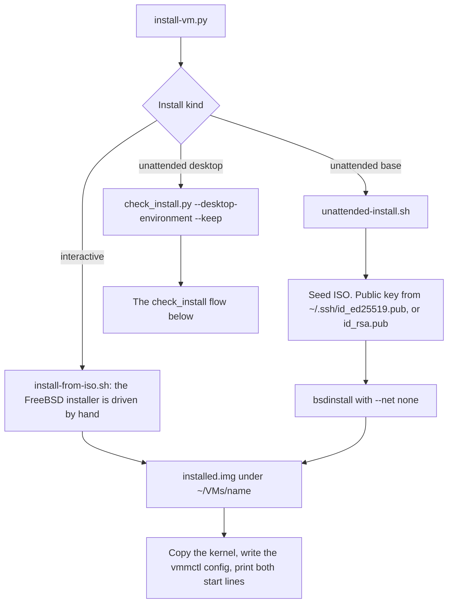
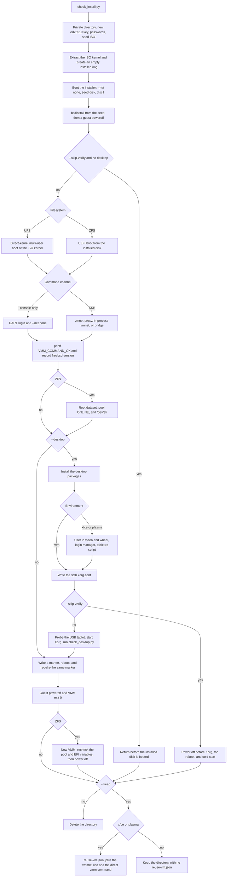

# Full installation regression

`scripts/check_install.py` exercises unattended FreeBSD installation, boot
from the installed disk, SSH command execution, guest reboot, and persistence.
It uses the seed generator from the unattended installer in a private working
directory. UFS with direct-kernel boot is the default; `--filesystem zfs
--firmware firmware/QEMU_EFI.fd` selects UEFI/ZFS and adds a cold-start check.
It never accepts an existing destination disk.

`scripts/install-vm.py` is the operator front door. A desktop choice runs this
script. A base install uses the shell installer instead.



`verify.py` also calls `check_install.py`, without `--keep`. A passing suite
deletes that guest. The desktop install keeps it.



Any failed step keeps the directory and writes `failure.txt`. That path does
not reach the cleanup decision above.

Prerequisites:

- Apple Silicon macOS, Python 3, Xcode command-line tools, and the system
  `tar`, `hdiutil`, `ssh`, and `ssh-keygen` commands.
- A built VMM signed with the Hypervisor entitlement (`make all`), and `dtc`.
- A local FreeBSD ARM64/aarch64 **disc1** ISO containing `base.txz` and
  `kernel.txz`. Boot-only media cannot perform this offline installation.
- For default SSH checks: the vmnet service (`make vmnet-service`), started
  as your user. SSH uses the DHCP-discovered guest address. Pass `--sudo` for
  in-process vmnet, or `--net bridge:en0` for in-process bridge on that
  Ethernet interface. `--console-only` runs offline UART command checks
  with `--net none`.
- Space for a sparse 12 GiB disk (several GiB actually written), and 2 GiB of
  available guest RAM. These defaults can be changed through CLI options.

From the repository root:

```sh
make all
python3 scripts/check_install.py target/debug/cube \
  --iso FreeBSD-14.4-RELEASE-arm64-aarch64-disc1.iso
```

The installer runs without networking. The installed guest uses `--net vmnet-proxy`
and `--ssh-port` on an automatically selected loopback port; use `--ssh-port
2223` to select a fixed port. Pass `--sudo` to re-run the script as root and
boot the guest with in-process `--net vmnet`, which can modify host IP
forwarding and its PF NAT anchor. Pass `--net bridge:en0` to boot that guest
on the in-process bridge instead. The bridge uses LAN DHCP and does not
install the NAT anchor. These network settings do not apply to
`--console-only`. The same choices are `--suite full`, and, started with
`sudo python3`, `--suite full --sudo --keep-root` and
`--suite full --bridge en0 --keep-root`. See
[verification.md](verification.md).

`--desktop` extends the UFS SSH run with a 1024×768 VNC framebuffer, enables
FreeBSD's `usbhid`/`hms` absolute-tablet path, installs Xorg/scfb plus a minimal
twm/xterm desktop, verifies XI2 input and reconnect
behavior, and records framebuffer update costs. It requires guest package
network access and is incompatible with `--console-only` and ZFS mode. See the
[desktop runbook](freebsd-desktop.md).
`--desktop-environment xfce` selects an unattended XFCE package installation
instead of twm/xterm, enables D-Bus and LightDM, and checks the graphical login
services after reboot. `--desktop-environment plasma` installs minimal Plasma 6,
Konsole, D-Bus, and SDDM and verifies the X11 login manager after reboot. Both
options imply `--desktop` and remain opt-in guest checks;
the full verifier continues to use the smaller, previously validated twm path.
For new full desktop installs, `--desktop-user NAME` and `--desktop-password-file PATH`
replace the default `vmm` login and generated desktop password. The root
account has a separate password. By default it is generated and recorded in
`root-login.txt` inside retained artifacts; pass `--root-password-file PATH` to
choose it for a new install. The desktop password defaults to the root password
unless `--desktop-password-file` is also supplied. Each password file must hold
one nonempty UTF-8 line. The options do not change an existing installed VM;
see the [desktop runbook](freebsd-desktop.md) for that procedure.

The convenience wrapper below selects Plasma, raises the resource and setup
timeout defaults, keeps the successful image, and writes `reuse-vm.json`:

```sh
./scripts/unattended-plasma-install.sh \
  --iso FreeBSD-14.4-RELEASE-arm64-aarch64-disc1.iso \
  --artifacts "$HOME/VMs"
```

Each run allocates a mode-0700 directory containing its new disk, seed ISO,
extracted kernel, SSH key, known-hosts file, UART mailboxes, command manifests,
console logs, VMM logs, guest versions, input hashes, and command results.
`--artifacts /path/to/existing/parent`
selects the parent directory. No user SSH configuration or keys are used.
`--keep` retains successful runs; failures always retain everything and print
the directory. Retained artifacts include the disposable guest's credentials.
Cleanup stops only VM processes launched by this run. Successful cleanup deletes
only the newly created directory.

The runner requires a unique, standalone success result from `bsdinstall`, a
guest PSCI poweroff, and a zero VMM exit status. It then starts another VMM with
only the installed disk attached. Direct-kernel boot uses the kernel extracted
from the same ISO; this does **not** test the on-disk EFI bootloader or installed
kernel loading. UEFI/ZFS mode loads both from the installed disk and verifies
the root dataset, pool health, EFI-variable persistence, and boot order across
cold start. See the [ZFS runbook](freebsd_zfs_runbook.md). The EFI-store path
is private; direct-kernel UFS boot does not use it.

SSH must execute a command, create and sync a unique marker, and report the guest
boot time. After requesting reboot, the runner requires a new PSCI reset,
returning SSH, a changed boot time, and the exact persisted marker. It finishes
with a guest poweroff and another clean VMM exit. An SSH connection alone cannot
pass the reboot check. Console-only mode makes the same guest assertions through
UART login and commands, without claiming SSH verification. ZFS cold start uses
the boot and shutdown timeout limits again for the new VMM process.

Default phase limits are 900 seconds for installation, 180 seconds for boot,
1200 seconds for optional desktop setup, 180 seconds for reboot, and 60 seconds
for final shutdown. Override them with `--install-timeout`, `--boot-timeout`,
`--desktop-timeout`, `--reboot-timeout`, and `--shutdown-timeout`. Preparation
commands and individual SSH attempts also have timeouts. Port allocation has a
small release-to-bind race; a collision fails the run and is recorded in the
VMM log.

The runner's failure guards can be tested without a guest or sudo:

```sh
python3 -B scripts/test_check_install.py
```

## Recorded validation, 2026-09-21

The user confirmed a complete successful privileged run with FreeBSD
14.4-RELEASE ARM64 disc1, a newly created 12 GiB disk, two vCPUs, and 2048 MiB RAM:

```sh
sudo python3 scripts/check_install.py /tmp/vmm-gui-fix/debug/vmm \
  --iso FreeBSD-14.4-RELEASE-arm64-aarch64-disc1.iso
```

Reported output:

```text
Artifacts: /private/tmp/vmm-install-cozefmu_
PASS unattended installation and clean poweroff
PASS installed disk boots without media and executes SSH commands
PASS guest reboot, new boot time, persistent marker, and returning SSH
PASS final clean poweroff
PASS full install → boot → reboot regression
```

This completes roadmap item 2 for direct-kernel UFS boot. The successful run used
default cleanup, so its temporary artifact directory was removed. All ten local
failure-guard tests also passed. An earlier unprivileged run passed installation
and clean poweroff, then failed at vmnet startup with permission denied; that run
verified failure reporting and diagnostic retention.
