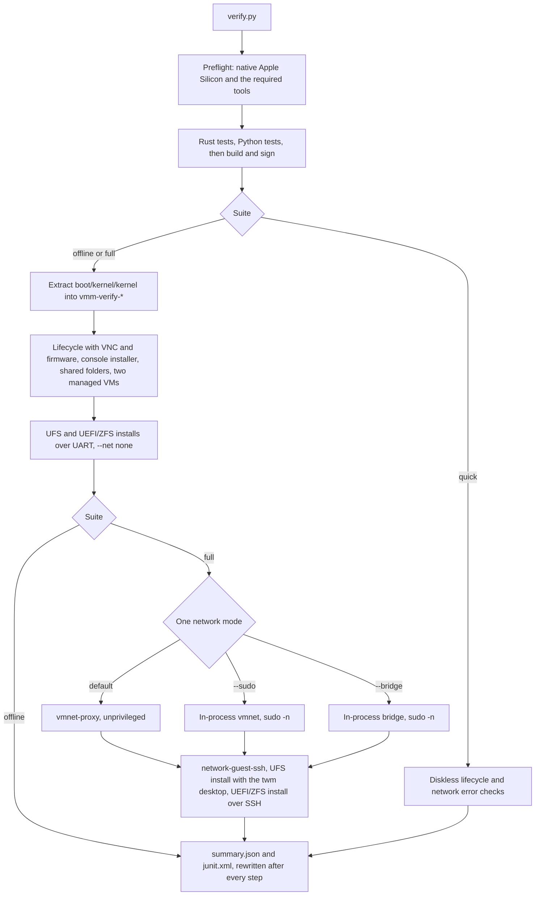

# Running the verification suites

Use `scripts/verify.py` as the single entry point after code changes and in CI.
It builds and signs a debug VMM, runs Rust tests in debug and release, discovers
all `scripts/test_*.py` tests, and invokes the existing integration scripts.
Checks run sequentially, except the management check intentionally boots two
isolated VMs together to exercise concurrent ownership.



A step whose dependency failed is skipped. Each install check creates
`vmm-install-*` under the suite directory and deletes it when that check
passes. The install flow inside those checks is the chart in
[install-regression.md](install-regression.md).

## Quick checks after a code change

From the repository root:

```sh
python3 -B scripts/verify.py
# Equivalent:
make verify
```

This needs native Apple Silicon macOS, Rust/Cargo, Xcode command-line tools,
Python 3, `dtc`, and the system `codesign`, `bash`, and `ssh-keygen` commands.
The machine must allow Hypervisor.framework execution. Rosetta, Linux, and hosts
without usable virtualization are not supported by this suite. The runner does
not download dependencies, guest media, or firmware explicitly; Cargo may need
network access for uncached dependencies.

The default `quick` suite needs no ISO, firmware, or sudo. It includes diskless
VM lifecycle checks and network startup/error checks. Passing it does not claim
that a full installation or guest networking was tested.

## All offline checks

Provide an ARM64 **disc1** ISO containing `base.txz` and `kernel.txz`, plus EDK2
firmware. The runner extracts the kernel into its private artifact directory.

```sh
python3 -B scripts/verify.py --suite offline \
  --iso FreeBSD-14.4-RELEASE-arm64-aarch64-disc1.iso \
  --firmware firmware/QEMU_EFI.fd
```

This additionally needs `hdiutil`, `tar`, and `ssh`. It runs without root and uses
serial-console commands for disposable UFS and UEFI/ZFS installations. Allow
2 GiB guest RAM and several GiB of disk space per installation. A passing
install deletes its disk. A failed install leaves `vmm-install-*` inside the
suite directory; repeated failures can consume substantial space. See
[Retained install directories](#retained-install-directories).

## Full suite, including real networking

The same three guest checks run in one network mode per invocation:
`network-guest-ssh`, the UFS install with SSH and the desktop, and the UEFI/ZFS
install with SSH. Choose an **unused** guest IPv4 address and a reachable host
address on that subnet. The runner validates subnet consistency, but cannot
establish whether an address belongs to another machine. Replace the examples
when your subnet differs. Run these as separate invocations.

`vmnet-proxy`, with the service already started by `make vmnet-service`. The
guest checks do not elevate. Do not put `sudo` in front of `python3`.

```sh
python3 -B scripts/verify.py --suite full \
  --iso FreeBSD-14.4-RELEASE-arm64-aarch64-disc1.iso \
  --firmware firmware/QEMU_EFI.fd \
  --guest-cidr 192.168.2.77/24 --host-ip 192.168.2.1
```

In-process `vmnet`. Start the process with `sudo` and pass `--sudo --keep-root`.
The suite stays root, so the later `sudo -n` step does not need a terminal
ticket. `--sudo` passes `--net vmnet` to the three guest checks. This path
can modify host IP forwarding and the PF NAT anchor. The Cargo `target`
directory is owned by root. The result directory is handed back to the
`sudo` user, and the Python unit tests run as that user so they can create
temporary directories in it.

```sh
sudo python3 -B scripts/verify.py --suite full --sudo --keep-root \
  --iso FreeBSD-14.4-RELEASE-arm64-aarch64-disc1.iso \
  --firmware firmware/QEMU_EFI.fd \
  --guest-cidr 192.168.2.77/24 --host-ip 192.168.2.1
```

In-process bridge. Stop the vmnet service first so the guest is attached only
to the bridge. The interface and LAN subnet change between networks. Print
the command for the adapter that is up now:

```sh
python3 -B scripts/verify-bridge.py
```

That writes a `sudo python3 -B scripts/verify.py --suite full --bridge IFACE
--keep-root` command. `IFACE` is an active Ethernet port when one has an
address. Otherwise it is the default route, including Wi-Fi. vmnet accepts a
bridged start on Wi-Fi, and guests take addresses from the DHCP server on
that interface. `--host-ip` is this Mac's address on that interface, and
`--guest-cidr` is an address in that subnet that did not answer. `--iface` and `--guest-ip` override those choices. Bare `--bridge`
on `verify.py` still follows the default route. Bridge does not install the
host NAT rule.

`--sudo` and `--bridge` cannot be combined. Neither flag opens a password
prompt or silently substitutes mock networking. `--keep-root` is what keeps
the build and the guest checks in the root process. Without it, `sudo python3`
drops back to `SUDO_UID` before any step runs, and `sudo -v` followed by an
unprivileged `python3` does the same. `sudo-access` then runs `sudo -n true`
in a new session with no terminal. macOS will not apply the per-terminal
ticket there, so that step fails and the three guest checks are skipped.
A CI host with noninteractive sudo for the test user can omit `--keep-root`.
`--keep-root` without `sudo` in front of `python3` is rejected. The
shared-folder check still needs `SUDO_UID` so it can hand its export back to
your user. `sudo python3` sets that. A root login that does not is rejected
by that check.
A binary signed with `com.apple.vm.networking` can create an in-process
interface without root when launched by hand; these two flags still elevate
the guest checks. Pass an already signed binary with `--binary` so the suite
does not re-sign it.
The shell installers (`unattended-install.sh`, `install-from-iso.sh`) already
prefix `sudo` only on the `vmm` binary. `check_install.py`, `check_network.py`,
and `vmmctl.py` still re-enter root for the whole driver when in-process
networking is selected: that driver has to stop the VM, and the EFI store and
serial log are created by the same user that executes `vmm`.
If `check_shared_folders.py` itself is started as root, it creates its
disposable export separately under `/private/tmp` and assigns it to the
original sudo user. The step's artifact directory contains `export-path.txt`.
A root launch without `SUDO_UID`/`SUDO_GID` cannot run that check.
The network SSH check retains `network-guest-ssh.console.log` beside its step
log so a failed guest setup can be distinguished from a forwarding failure.
Run the full suite on an appropriate test host.

| Check | quick | offline | full |
|---|:---:|:---:|:---:|
| `cargo test --locked` and `--release` | yes | yes | yes |
| Offline COW inspect/export, malformed-input and lock tests (Rust) | yes | yes | yes |
| Python `test_*.py` discovery | yes | yes | yes |
| Build and sign VMM (or verify `--binary`) | yes | yes | yes |
| `check_vm_lifecycle.py`: diskless CPU/reset | yes | yes | yes |
| Lifecycle: custom-resolution FreeBSD VNC, metrics, and firmware | — | yes | yes |
| `check_network.py`: startup and bind errors | yes | yes | yes |
| `check_unattended_console.py` | — | yes | yes |
| Shared folders: host/guest changes, permissions and reboot | — | yes | yes |
| Two concurrent managed FreeBSD VMs and listener collision | — | yes | yes |
| `check_install.py`: UFS offline | — | yes | yes |
| `check_install.py`: UEFI/ZFS offline, reboot/cold start | — | yes | yes |
| Network: alternate static address and SSH forwarding | — | — | yes |
| Installation: UFS and UEFI/ZFS with SSH | — | — | yes |
| FreeBSD X11/scfb input and update measurements | — | — | yes (UFS) |

The interactive installation, signing, seed-generation, and cleanup utilities
are not independent tests and are not executed as top-level verification steps.
Their relevant behavior is exercised by the existing checks. New Python unit
test files matching `test_*.py` are discovered automatically; new integration
scripts should be added explicitly to `make_plan()` in `scripts/verify.py`.
The full suite's UFS SSH installation passes `--desktop` to
`check_install.py`. It installs Xorg/scfb in that disposable guest, invokes
`check_desktop.py`, and retains its X11 event and performance evidence in the
suite artifact directory. See
[FreeBSD desktop verification](freebsd-desktop.md).
The standalone UFS `--desktop --keep` run passed on 2026-09-22, including all
three X11/VNC checks and the subsequent reboot and clean poweroff. The 32
framebuffer updates averaged 38.4 updates/s and 14.0 MiB/s raw payload.

## Options and results

- `--list` prints the selected commands without executing them or creating
  artifacts. Supply the suite's required input arguments; files need not exist
  for listing.
- `--target-dir PATH` selects the Cargo build directory. It defaults to
  `CARGO_TARGET_DIR` when set, otherwise the repository's `target` directory.
- `--binary PATH` uses an existing signed VMM and skips build/sign; Rust tests
  still compile and run. Use this to validate a separately built release binary.
  Without it, integration checks use the newly built debug binary.
- `--artifacts PATH` selects the parent of a new private `vmm-verify-*` directory.
  The default is the gitignored `test-results/` directory. Paths supplied on the
  command line resolve relative to the caller's current directory; commands run
  from the repository root.

Each step has a retained `.log`, with its exact command at the top. Output shows
step starts, results, and failure log tails. The runner continues independent
checks after failure; checks whose setup failed are explicitly marked skipped.
It rewrites `summary.json` and `junit.xml` after each step and on handled
cancellation. JUnit contains one testcase per top-level step; detailed Rust and
Python test output remains in the step logs.

Exit status is `0` only when all selected steps pass, `1` on failure or dependent
skips, `2` for invalid CLI arguments, and `130` on handled interruption. Missing
prerequisites fail preflight and appear in both reports. Unselected suites are
reported as excluded coverage, not as passing checks.

Outer limits are 15 minutes for each Cargo step, 5 minutes for normal check
scripts, 30 minutes for ordinary install workflows, and 50 minutes for the UFS
desktop workflow; installation phases also retain their own internal timeouts.
On a timeout or Ctrl-C/SIGTERM, the runner
interrupts the current check and gives its cleanup handlers 30 seconds to stop
VMs before forcing termination. Uncatchable termination such as SIGKILL or host
loss cannot guarantee cleanup or a final report.

Logs and reports are always retained. Successful install workflows delete their
disposable images. Privileged failures may leave root-owned artifacts.
Older lifecycle/network check scripts still clean their own temporary files;
the outer logs preserve their output and printed diagnostics.

## Retained install directories

`extract-kernel` writes one file, `boot/kernel/kernel`, under `vmm-verify-*`.
Lifecycle, the console installer, shared folders, VM management, and the
network guest check boot that copy. It is the kernel from the ISO. That
directory has no installed disk.

Each `check_install.py` step creates `vmm-verify-*/vmm-install-*/` when the
step starts and extracts the same ISO member again to
`vmm-install-*/boot/kernel/kernel`. The offline suite runs
`install-ufs-offline` and `install-zfs-offline`. The full suite adds
`install-ufs-ssh` and `install-zfs-ssh`. The quick suite does not run these
steps. The two kernel files are separate copies of the same bytes. The install
check boots its own copy, for the installer and for the later boot of
`installed.img`. Neither folder receives the rest of the ISO `/boot` tree;
a ZFS install loads `zfs.ko` inside the guest from the disc.

A passing install deletes its `vmm-install-*` directory before the step
returns. The directory is still present while the step runs. It remains after
the step when the install fails, times out, or is interrupted before that
delete. `failure.txt` records the error. `run.json` records the filesystem and
whether the run was console-only or a desktop. A `--sudo` or `--bridge` failure
can leave the directory owned by root.

`installed.img` is created as an empty 12 GiB sparse file before `bsdinstall`
runs, so the file alone does not mean the guest is installed. The disk is
bootable when the step log contains `PASS unattended installation and clean
poweroff`. The root password is in `root-login.txt`. `id_ed25519` is the SSH
key the seed authorized. The guest hostname is `vmm-install-test`.

The suite does not pass `--keep` and does not write a `vmmctl` config. To keep
a guest after a run that passes, use `scripts/install-vm.py` or
`scripts/check_install.py --keep`.

### Start a retained disk

Start the vmnet service once with `make vmnet-service`. From the repository
root, a UFS disk (`"filesystem": "ufs"` in `run.json`) boots with the kernel
in that same `vmm-install-*` directory:

```sh
INSTALL=test-results/vmm-verify-XXXX/vmm-install-YYYY
./target/debug/cube \
  --freebsd "$INSTALL/boot/kernel/kernel" --multiuser \
  --disk "$INSTALL/installed.img" \
  --ram 2048 --cpus 2 \
  --efi-vars "$INSTALL/efi-vars.fd" \
  --net vmnet-proxy --ssh-port 2222
```

A ZFS disk uses the EDK2 firmware passed to `verify.py` and that directory's
`efi-vars.fd`:

```sh
./target/debug/cube \
  --uefi firmware/QEMU_EFI.fd \
  --disk "$INSTALL/installed.img" \
  --ram 2048 --cpus 2 \
  --efi-vars "$INSTALL/efi-vars.fd" \
  --net vmnet-proxy --ssh-port 2222
```

```sh
ssh -F /dev/null -i "$INSTALL/id_ed25519" -p 2222 \
  -o IdentitiesOnly=yes -o StrictHostKeyChecking=accept-new \
  root@127.0.0.1
```

The password is also in `root-login.txt`. The full suite's UFS SSH check
passes `--desktop` and installs the twm packages used for the X11 measurement.
That session is not enabled at boot, so the command above starts multi-user
FreeBSD with SSH. A graphical login comes from `scripts/install-vm.py
--desktop` or `check_install.py --desktop-environment`.

## CI usage

Use a trusted native Apple Silicon macOS runner with Hypervisor.framework
available and the prerequisites above. Prepare Cargo dependencies, ISO, and
firmware ahead of time. The same command works without CI-specific wrappers:

```sh
python3 -B scripts/verify.py --suite offline \
  --iso /path/to/FreeBSD-arm64-disc1.iso \
  --firmware /path/to/QEMU_EFI.fd \
  --artifacts "$PWD/test-results"
```

Preserve the command's exit status. Configure the CI system to collect
`test-results/vmm-verify-*/junit.xml`, `summary.json`, and top-level `*.log` even
when the command fails. Do not recursively publish retained guest disks, keys,
or seed images as public CI artifacts. Set the job timeout above the expected
suite duration so normal cancellation can run cleanup.

For the full suite, use the same command with `--suite full`, the explicit
network addresses, and `--sudo` or `--bridge IFACE` when that mode is the one
under test. No particular hosted CI runner
image or nested-virtualization capability is assumed.

## Validation, 2026-09-22

The quick suite passed using an existing signed binary. The complete offline
suite passed all 12 top-level steps, including build/sign, 39 Rust tests in each
profile, 23 Python tests, and real UFS/ZFS installations with reboot and ZFS cold
start. JSON and JUnit reports were checked for consistent results. The full
suite's selection and dependencies are unit tested; its privileged networking
steps were not run during this runner change.
