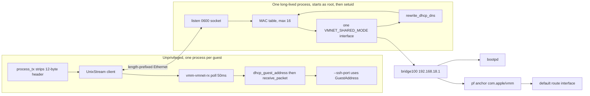
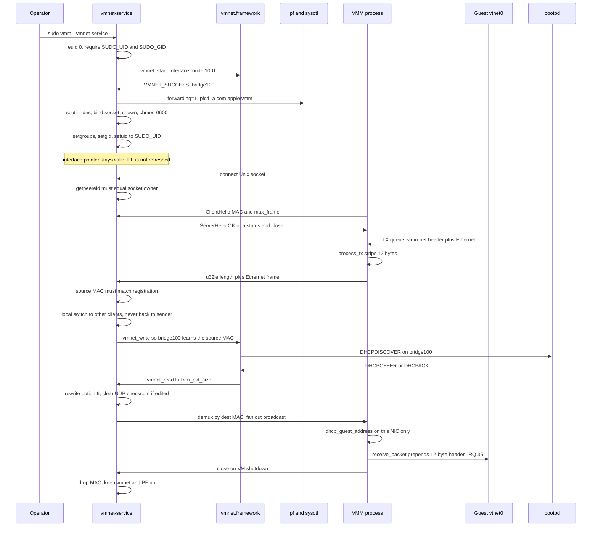

# Design: unprivileged VMM with a long-running vmnet service

| | |
|---|---|
| Author | TBD |
| Date | 2026-09-28 |
| Status | Approved. `--net vmnet` stays in-process; `--net vmnet-proxy` is the socket client. |
| Workspace | `/Users/darcy/Dev/vmm` |
| Binary | Rust ARM64 VMM (`vmm`), Hypervisor.framework, virtio-mmio, synthesized FDT |

## Overview

`--net vmnet` today starts macOS `vmnet.framework` inside the VMM process. Shared mode and the PF NAT anchor `com.apple/vmm` both require root, so the whole VMM is launched under `sudo` (`Makefile` targets `sudo-freebsd-net`, `sudo-freebsd-zfs`, `sudo-freebsd-zfs-uefi`). Hypervisor.framework does not need root. The ad-hoc signature in `entitlements.plist` carries only `com.apple.security.hypervisor`. Adding the restricted entitlement `com.apple.vm.networking` to that ad-hoc signature makes AMFI SIGKILL the process (`Killed: 9`); see `docs/entitlements.md`.

This design splits the privilege boundary at Ethernet frames. A single long-running process, started once as root with `sudo ./target/debug/vmm --vmnet-service`, owns one `VMNET_SHARED_MODE` interface, the existing PF anchor, and a DHCP option-6 rewrite. Later VMM processes run as the invoking user, connect to a filesystem Unix socket, and exchange raw Ethernet frames. Virtio-net, the guest IRQ, queue processing, `bootpd` on `bridge100`, subnet `192.168.18.0/24`, and `--ssh-port` lease learning stay where they are. `--net vmnet` stays today's in-process shared mode and still calls `vmnet_*`, `pfctl`, and `sysctl -w`. The new unprivileged client is `--net vmnet-proxy`. It does not call them. Bridge mode still calls `vmnet_*` in-process and does not install NAT.

The vmnet interface pointer cannot be passed to another process. Only frames cross the socket. If the service is not listening, `--net vmnet-proxy` fails the process. It does not fall through to `UserMockBackend`, and it does not fall through to in-process `--net vmnet`.

`--net vmnet-proxy` never calls `vmnet_start_interface`, `vmnet_read`, `vmnet_write`, `vmnet_stop_interface`, `pfctl`, or `sysctl -w`, including when that process is root. Root on the proxy socket is `UNAUTHORIZED`. `--net vmnet` and `--net bridge[:iface]` remain the in-process paths. See [In-process shared mode](#in-process-shared-mode-kept) and [Bridge mode](#bridge-mode-unchanged).

## Background & Motivation

### Current path

`VirtioNet::new` (`src/devices/virtio/net.rs`) matches `backend_choice == "vmnet"` and calls `VmnetBackend::new` → `VmnetBackend::start(VMNET_SHARED_MODE, None)`. Mode constants in that file, verified against the source:

| Constant | Value |
|---|---|
| `VMNET_HOST_MODE` | 1000 |
| `VMNET_SHARED_MODE` | 1001 |
| `VMNET_BRIDGED_MODE` | 1002 |
| `VMNET_SUCCESS` | 1000 |
| `VMNET_FAILURE` | 1001 |
| `VMNET_INTERFACE_PACKETS_AVAILABLE` | 1 |

`vmnet_start_interface` runs with an XPC dictionary key `vmnet_operation_mode`. On `VMNET_SUCCESS` for shared mode, `VmnetBackend::setup_host_nat` runs `sysctl -w net.inet.ip.forwarding=1` and pipes rules into `pfctl -a com.apple/vmm -f -`. The Makefile macro `setup-vmnet-nat` does the same thing before `sudo $(VMM_BIN)`, using `route get default` to find the outbound interface. The rules are:

```
nat on IF from 192.168.18.0/24 to any -> (IF)
pass in quick on bridge100 all
pass out quick on IF all
```

`setup_host_nat` discovers the interface with a different parser (`netstat -rn -f inet`) and discards `pfctl` stderr (`Stdio::null()`). The Makefile parser (`route get default`, line prefix `interface:`) is the one `default_host_iface()` already uses for bridge mode. NAT failure is silent today, which is how guest packets used to leave the host with source `192.168.18.2` and die at the upstream router (`docs/networking.md`, Root Cause 4).

TX: MMIO `VIRTIO_MMIO_QUEUE_NOTIFY` for queue 1 calls `process_tx`, which strips the 12-byte virtio-net header (`VIRTIO_NET_HDR_SIZE` in `src/devices/virtio/mod.rs`) and, after dropping the device lock, calls `NetBackend::send_packet`. `VmnetBackend::send_packet` calls `vmnet_write`. Any status other than `VMNET_SUCCESS` increments `NET_STATS.vmnet_err`. The MMIO path ignores the `Result` (`let _ = b.send_packet`).

RX: thread `vmm-vmnet-rx` polls `vmnet_read` into a 2048-byte buffer. Empty reads sleep 100 µs. A successful read uses `desc.vm_pkt_size` clamped to the buffer length, then `dhcp_guest_address`, then `patch_dhcp_response`, then `receive_packet`. `dhcp_guest_address` returns `Some(ip)` only for a complete DHCPv4 ACK (BOOTP op/htype/hlen, chaddr equals this NIC, magic cookie `99 130 83 99`, option 53 = 5, yiaddr unicast). That `Ipv4Addr` is stored in `forward::GuestAddress`. `--ssh-port` (`forward::start_ssh_forward`) waits on it and does not guess `192.168.18.2`. `patch_dhcp_response` rewrites DHCP option 6 when the address is `192.168.x.1` (the bridge gateway, which does not resolve) to `1.1.1.1` and clears the UDP checksum (RFC 768 allows 0). Both parsers walk the Ethernet/IPv4/UDP/BOOTP frame through the options. A truncated prefix makes `dhcp_guest_address` return `None` (the unit test iterates every prefix) and can skip the DNS rewrite.

`receive_packet` keeps an in-order backlog of at most 64 frames when the RX virtqueue is not ready or has no writable descriptors, then drops and increments `rx_drop`. The device does not negotiate mergeable RX buffers. Advertised features are `VIRTIO_NET_F_MAC`, `VIRTIO_NET_F_STATUS`, and `VIRTIO_F_VERSION_1` only. Guest MTU stays 1500. MMIO net device: GPA `0x0a000200`, IRQ 35.

Default MAC is `52:54:00:12:34:56` (`--mac` / `parse_mac` in `src/main.rs`). `scripts/vmmctl.py` already derives a distinct `52:54:` MAC from the VM name. Two processes that both keep the CLI default are one DHCP client on `bootpd` and fight a single lease.

Failed and unknown backends already return `Err` from `VirtioNet::new`. `boot_os_kernel` propagates that with `?`, and `finish_boot` prints `[VMM Error]` and exits. The test `failed_or_unknown_backends_do_not_become_mock` locks this in. `scripts/check_network.py` asserts the mock banner is absent.

### Why a service, not a helper spawned per launch

`src/shared_fs/mod.rs` already re-execs the same binary as `--internal-9p-worker` and, when the parent is root, drops to `SUDO_UID` / `SUDO_GID` with `setgroups` + `setgid` + `setuid` before the child runs. That pattern is the inverse of what networking needs: the long-lived process must be the privileged one, and the VMM must not be. The 9p child also inherits stdio pipes from the parent. This machine's sudo 1.9.17p2 closes every file descriptor above stderr before `exec`, and `--close-from` is allowed only when sudoers sets `closefrom_override`. A design that `socketpair`s and then `sudo`s a helper cannot see the socket. The unprivileged VMM must `connect` to a path the service is already listening on.

`VmnetBackend::Drop` calls `vmnet_stop_interface`. A per-launch helper would tear the interface down on every guest exit and race PF reinstall. One process, one interface, many attachments.

### Guest requirement (not a VMM feature)

The service does not assign addresses. `bootpd` on `bridge100` (`192.168.18.1`) is the only DHCP server. A guest that never sends DHCPDISCOVER never gets a lease. FreeBSD multi-user runs `dhclient` on `vtnet0`. A Linux guest needs kernel `ip=dhcp` or an in-guest client (systemd-networkd or equivalent). Static `ip=192.168.18.2` on two instances collides; the multi-instance behavior is DHCP per MAC. `--forward` remains the tool for a static guest address, and the operator picks a free address on `192.168.18.0/24`. `--ssh-port` still requires a real ACK for this MAC.

## Goals & Non-Goals

### Goals

- Run the VMM as the invoking user with working guest internet on the existing shared subnet.
- One root service, started once: `sudo ./target/debug/vmm --vmnet-service`. Clients: `./target/debug/vmm --net vmnet-proxy ...` with no sudo.
- One `VMNET_SHARED_MODE` interface for every attached guest. The default is the shared network macOS already created (`bridge100` and `bootpd`). `--subnet CIDR` (or `make vmnet-service SUBNET=192.168.18.0/24`) asks vmnet for an RFC1918 `/8`–`/30`: gateway is the first host, and DHCP runs through the last host. PF NAT follows the prefix vmnet reports, which can differ from the request. Anchor `com.apple/vmm` stays.
- Proxy Ethernet frames only. Virtio-net header strip and RX delivery stay in the VMM.
- Learn the guest IPv4 from the DHCP ACK on the VMM side of the socket (`dhcp_guest_address` + `forward::GuestAddress`).
- Refuse a second connection that registers a MAC already attached.
- Rewrite DHCP option 6 in the service, once, on the way from `vmnet_read` to the client socket. Prefer host resolvers the guest can route to through PF NAT. Fall back to `1.1.1.1` and `8.8.8.8`. Do not run a DNS proxy on the gateway.
- Fail `--net vmnet-proxy` with an explicit error when the service is down. Never select mock. Never fall through to in-process shared mode.
- Keep today's in-process shared mode as `--net vmnet`. It still requires root, still calls `vmnet_start_interface` and `setup_host_nat`, and still tears the interface down when that VMM exits.
- Unit tests that do not need sudo. One live check that still needs the service: `scripts/check_network.py`.

### Non-Goals

- OpenAI softnet, per-VM `/30`, a userspace DHCP server, a stateful flow cache, or JSON-RPC policy. Do not vendor or exec `https://github.com/openai/softnet`.
- Obtaining `com.apple.vm.networking` from Apple. `entitlements.plist` stays hypervisor-only. `entitlements.networking.plist` and `make sign-networking` stay as the optional Developer ID path and are not how local internet works.
- Changing FreeBSD boot, ZFS/MODINFO, virtio queue layout, FDT, or the 12-byte virtio-net header.
- A userspace TCP stack (slirp).
- Replacing in-process `--net bridge[:iface]`. That path stays in the VMM and still needs root. The service can also bridge: `vmm --vmnet-service --bridge [iface]`. See [Bridge mode](#bridge-mode-unchanged).
- Changing `--net mock`, `--net none`, or `tap:`. Those stay local and unprivileged. Tap still has no RX thread.
- Daemonizing the service, launchd plists, or refreshing PF when the default route changes without a restart.
- Isolating guests from each other beyond MAC registration. Attached clients share one L2 segment because the service switches frames locally (a bridge does not hairpin them back out the single vmnet port). The service does not filter ARP and does not give each guest a private segment.

## Proposed Design

### Process model



The service is not a child of the VMM and is not spawned per guest. Early dispatch matches `--internal-9p-worker`: `main` checks `args[1]` and returns before `run_cli`, the GUI thread, and VM setup.

```text
sudo ./target/debug/vmm --vmnet-service [--vmnet-socket PATH]
./target/debug/vmm --net vmnet-proxy [--vmnet-socket PATH] [--mac MAC] ...
```

`--vmnet-service` accepts only `--vmnet-socket`. Any kernel, disk, `--net`, or `--share` argument is an error. The service does not call `Vm::new` and does not need the hypervisor entitlement to do its job, but it is the same ad-hoc-signed binary; root is what authorizes `vmnet_start_interface`.

### Why one shared interface can carry many MACs

`bridge100` is an L2 bridge. One vmnet port is one bridge port. The bridge FDB may map several source MACs onto that port, the same way a physical port toward a downstream switch does, which is how host and `bootpd` traffic still reach every guest: those peers sit on other ports. A standard bridge does not hairpin a frame back out the ingress port. Guest A to guest B is therefore not delivered by `vmnet_read` of a frame the service just wrote. Today that path works only because each VMM calls `vmnet_start_interface` and is its own bridge port. After this design every guest is behind one port, so the service itself is the downstream switch.

`start_shared` builds `interface_desc` the way `VmnetBackend::start` does today: one key, `vmnet_operation_mode` = `VMNET_SHARED_MODE` (1001). Do not set `vmnet_mac_address_key`, `vmnet_allocate_mac_address_key`, `vmnet_mtu_key`, or `vmnet_enable_virtio_header_key`. The header describes `vmnet_mac_address_key` as the single MAC "the VM is expected to use when originating traffic", and `vmnet_allocate_mac_address_key` defaults to true. Pinning that key to the first client would make the second guest worse. The allocated port MAC is not a guest MAC.

The completion handler is `vmnet_start_interface_completion_handler_t(status, interface_param)`. Today's `vmnet_completion_invoke` stores only the status and drops `interface_param`. The service reads, inside that callback before it returns, the uint64 `vmnet_mtu_key`, the uint64 `vmnet_max_packet_size_key`, and the string `vmnet_mac_address_key`, and logs all three. The virtio-net header stays in the VMM, so the `+ 12` note on `vmnet_max_packet_size_key` does not apply (that note is only when `vmnet_enable_virtio_header_key` is true). The read buffer is `max(2048, max_packet_size)` when the reported size is in `1..=16384`. Missing or zero keeps 2048, which matches today's `vmm-vmnet-rx` buffer. A reported size above 16384 fails startup with the value in the error. A `vm_pkt_size` that still exceeds the buffer is dropped whole (`rx_oversize`) and is not forwarded as a prefix. Socket records stay capped at 2048; a vmnet frame larger than a client's negotiated max is discarded under the record rules below, not truncated.

Guest-to-guest delivery is local switching on the TX path, not a second vmnet interface and not a hairpin:

1. Every accepted client frame is still `vmnet_write`n, so `bridge100` learns that source MAC and the host, `bootpd`, and the NAT see the frame.
2. The same frame is copied to other clients. Broadcast and multicast (`dest[0] & 1 != 0`) go to every client except the sender. A unicast whose destination is another registered MAC goes only to that client. Unicast to an unregistered MAC is not copied (it belongs to the host or the wire).
3. The copy is never enqueued back to the sender.
4. Local copies use the per-client `outq` policy. A full queue drops that recipient's copy (`drop_slow_client`) and still `vmnet_write`s the original.
5. On `vmnet_read`, a frame whose Ethernet source is a registered client MAC is a reflection of our own write. Count `rx_reflect` and drop it. Local switching already delivered it. This keeps a hairpin, if `bridge100` ever does one, from delivering the frame twice.

`bootpd` replies are often broadcast with the client hardware address in the BOOTP chaddr; `dhcp_guest_address` keys off chaddr, not the Ethernet destination, so each VMM still records only its own ACK. Those replies originate at the gateway, not at a client MAC, so the reflection filter does not eat them.

Two checks prove the two different faults. Both guests pinging `1.1.1.1` shows that vmnet delivered each guest's unicast from another bridge port. Guest A pinging guest B's address shows the local switch. Either can pass while the other fails. Unicast that arrives from vmnet for an unregistered MAC is counted (`rx_unclaimed`) and dropped, not flooded.

### Frame flow



Client disconnect does not call `vmnet_stop_interface` and does not flush the PF anchor. The `bootpd` lease remains until it expires. The same MAC may reconnect immediately, which is the guest-reboot case (new process, same `--mac`). A second live process with that MAC is rejected while the first fd is open.

Service exit (SIGINT, SIGTERM, or crash) closes client fds. Each VMM RX thread sees EOF, logs once, and stops. The guest keeps running with a dead NIC. Virtio link status stays up (`VIRTIO_NET_S_LINK_UP` is what config space always returns). Reconnect is out of scope; the operator restarts the VMM. `send_packet` fails with `EPIPE` because the client socket has `SO_NOSIGPIPE`, and the MMIO path ignores the error. A one-frame oversize discard does not take this path. Startup is different: connect failure fails `VirtioNet::new` before vCPUs run. The PF anchor is left installed, matching today (nothing in the Makefile removes it). Restarting the service replaces the anchor contents with `pfctl -f`. IP forwarding is set to 1 and never cleared on exit.

A second service probes the socket. If `connect` succeeds, it closes that fd and exits with `vmnet service already listening on {path}` and does not unlink. The probe is the same uid as the owner, so it passes `getpeereid`, sends no ClientHello, and must not be logged as `UNAUTHORIZED` or counted as a drop. The accept path logs a short read with no MAC at debug and closes. If the inode is a socket and `connect` fails with `ECONNREFUSED`, the previous process died and the file is stale: unlink and bind. If the path is a symlink, refuse and leave the symlink in place. `EADDRINUSE` after that probe is the same "already listening" error.

### Wire protocol

Stream socket (`AF_UNIX` / `SOCK_STREAM`), length-prefixed frames. Not datagrams.

macOS `unix(4)` guarantees `SOCK_STREAM` and `SOCK_DGRAM`, not `SOCK_SEQPACKET`. Datagrams drop when the receiver buffer is full (`ENOBUFS`) and would drop the DHCP ACK that `--ssh-port` blocks on. A stream preserves the ACK. The 9p helper already frames the same way: `u32` little-endian length plus payload (`shared_fs::Backend::request`). Backpressure on a stream is `EAGAIN` on a nonblocking write, not `ENOBUFS`. This code does not special-case `ENOBUFS`. `vmnet_write` status codes are handled in [Privilege](#privilege): authorization failures can exit the service, `VMNET_PACKET_TOO_BIG` and `VMNET_BUFFER_EXHAUSTED` are counted, and a partial socket record is never dropped.

`SO_NOSIGPIPE` is set on the listen socket, on every accepted fd, and on the VMM's connected socket before `try_clone`. macOS has no `MSG_NOSIGNAL`. One `setsockopt` covers both dups, because socket options are not per-fd. A write after the service has gone must return `EPIPE`. It must not raise `SIGPIPE`. Today's MMIO path ignores `send_packet`'s `Result` (`let _ = b.send_packet(&p)` in `net.rs`), so a signal would kill the VMM before that error is counted. Service EOF logs once from the RX thread and stops that thread. The virtio link bit stays up on purpose. Reconnect is out of scope; the operator restarts the VMM.

#### Handshake

Both messages are fixed size, little-endian. Magic is the 8 bytes `b"VMMNET\x01\x00"` (`VMMNET`, then `0x01`, then `0x00`). `b"VMMNET\x01"` is 7 bytes and does not fit `[u8; 8]`. Do not spell it `VMMNET01`.

ClientHello, 24 bytes, sent immediately after `connect`:

| Offset | Size | Field |
|---|---|---|
| 0 | 8 | magic |
| 8 | 4 | `version` = 1 |
| 12 | 6 | MAC, six octets |
| 18 | 2 | `flags`. Must be 0. Non-zero is status `UNSUPPORTED_VERSION`. Decode still consumes these two bytes. |
| 20 | 4 | `max_frame`, client's receive capacity |

ServerHello, 20 bytes:

| Offset | Size | Field |
|---|---|---|
| 0 | 8 | magic |
| 8 | 4 | `version` = 1 |
| 12 | 4 | `status` |
| 16 | 4 | negotiated `max_frame`, or 0 when `status != OK` |

Status codes:

| Code | Name | Meaning |
|---|---|---|
| 0 | `OK` | MAC inserted |
| 1 | `DUPLICATE_MAC` | This MAC is already in the table. First client stays. |
| 2 | `UNSUPPORTED_VERSION` | Magic, version, or non-zero `flags` |
| 3 | `REJECTED_MAC` | Zero, multicast, or broadcast MAC |
| 4 | `BAD_MAX_FRAME` | `max_frame` outside 1514..=2048 |
| 5 | `UNAUTHORIZED` | `getpeereid` uid is not the socket owner |
| 6 | `TOO_MANY_CLIENTS` | 16 clients already attached |

Check order on accept: peer uid, then a 2-second deadline to read a full ClientHello, then magic and version, then `flags`, then MAC, then `max_frame`, then the duplicate-MAC lookup, then capacity. Duplicate is before capacity so a 17th connection that reuses an attached MAC gets `DUPLICATE_MAC` (1), not `TOO_MANY_CLIENTS` (6). Status 6 is only a new MAC when 16 clients are already in the table. Any failure writes ServerHello if the fd is still writable, then closes, and does not insert. A short read or timeout closes with no insert and is not status 5. The second-service probe is that case; log it at debug.

Negotiated `max_frame` is `min(client.max_frame, 2048)`. The VMM always advertises 2048, matching the current `vmm-vmnet-rx` buffer. 1514 is the minimum because that is a standard Ethernet frame without FCS (14-byte header + 1500). The device does not negotiate `VIRTIO_NET_F_MRG_RXBUF`, so guests will not send jumbo frames. 2048 leaves headroom for a slightly oversized `bootpd` reply without truncating options.

#### Data records

After `OK`, both directions send records and nothing else:

```text
u32le length N
N bytes of Ethernet frame, no virtio-net header
```

One order, both directions. The length class is decided before any source-MAC check, `local_switch`, or `vmnet_write`.

| `N` | Action |
|---|---|
| EOF not on a record boundary, `N == 0`, or `N > 65536` | Close and free the MAC. The stream is no longer framed. Do not deliver a prefix to `dhcp_guest_address`, `rewrite_dhcp_dns`, `vmnet_write`, or another client. The VMM does not reconnect. |
| `1..=13` | Read and discard those `N` bytes. Increment `frame_runt` only. Leave the MAC. Do not call `vmnet_write` or `local_switch`, and do not read a source address (octets 6..12 are not in the buffer). The next record starts after those bytes, so the stream stays framed. Closing here would kill the NIC for one consumable record, which is the same outcome the oversize rule refuses. |
| `14..=negotiated max` | This is a frame. The TX source check below is the only path that may count `tx_spoof`. |
| `negotiated max < N <= 65536` | Read and discard those `N` bytes. Increment `frame_oversize` only, even if bytes 6..12 are not the registered MAC. Leave the MAC. Do not call `vmnet_write`, `local_switch`, or the source check. |

`frame_runt` and `frame_oversize` do not overlap, and neither is `tx_spoof`. The VMM's record reader uses the same classes. A runt or an oversize record is not passed to `dhcp_guest_address` or `receive_packet`. The oversize row covers a peer that negotiated 1514 and a frame in `1515..=2048`, and a vmnet frame larger than the client's 2048-byte advertisement. A normal 1500-byte MTU frame fits in 1514 and is not discarded. The VMM always advertises 2048, so the common negotiated max is 2048. Virtio config space keeps reporting link up (`0x106`/`0x107` return `VIRTIO_NET_S_LINK_UP` unconditionally, and `VIRTIO_NET_F_STATUS` is advertised). This cut does not drive that bit down on EOF or on a discarded frame. The guest keeps running. After EOF the NIC is silent until the operator restarts the VMM.

If `vmnet_read` reports `vm_pkt_size` larger than the read buffer, the service drops the whole packet, increments `rx_oversize`, and does not forward a prefix. The buffer is sized from `vmnet_max_packet_size_key` as described above so this is the leftover case, not the steady state.

There is no per-frame ack. The client's `send_packet` completes when the bytes are queued on the socket, same as today's fire-and-forget `vmnet_write`. A later `vmnet_write` failure is counted on the service and is not reported back.

#### TX source check

The source check runs only after the length table has classified the record as a frame (`14..=negotiated max`). It requires the Ethernet source address to equal the MAC registered on this connection. A mismatch increments `tx_spoof` only, leaves the connection up, and does not call `local_switch` or `vmnet_write`. A runt is not a spoof. An oversize record is not a spoof. A client that can connect can still emit arbitrary payloads under its own MAC, including ARP. It cannot answer DHCP or send frames as some other attached guest's MAC. Registration is not a private segment. Guests of the same service share L2 because of local switching, and they can ARP-spoof under the MAC they registered.

#### Backpressure

Three buffers, all bounded, none of them allowed to stall another client or `vmnet_read`:

| Stage | Cap | When full |
|---|---|---|
| VMM `rx_backlog` | 64 frames, already in `receive_packet` | RX thread stops reading the socket. Kernel `SO_RCVBUF` fills. |
| Service per-client `outq` | 64 whole frames, none of them yet written | A new frame is enqueued only when `outq.len() < 64`. The 65th increments `drop_slow_client` and is discarded before any byte of it is written. `EAGAIN` does not drop the record in progress. |
| Service `outbound` | one partial record | On `EAGAIN`, the unsent tail stays in `outbound`. `POLLOUT` finishes it. A record that has been partially written is never discarded and never closed for being slow. |
| Service read of a client | one partial inbound record | `vmnet_write` failure follows the status rules in [Privilege](#privilege). Do not retry a failed `vmnet_write` inside the poll loop. Local copies already queued are not pulled back. |

One policy, both directions. `EAGAIN` means "finish this record later", not "throw away the bytes already written". Dropping a frame whose length prefix has already hit the wire desynchronizes the peer, the record parser then sees a bad `N`, and that close is permanent because the VMM does not reconnect. Broadcast to a slow guest does not block a fast one: each client has its own `outq` and `outbound`.

`UnixStream::try_clone` is `dup`. File-status flags are shared, and so are socket options. `SocketBackend::connect` sets `SO_NOSIGPIPE` and `O_NONBLOCK` once, before the clone. Do not also call `set_read_timeout`. `SO_RCVTIMEO` does not time out an `O_NONBLOCK` socket; `read` returns `EAGAIN` immediately and the RX thread would busy-spin, or `Drop` would not get a bounded join.

The RX thread `poll`s its fd with a 50 ms timeout. On timeout, or on `WouldBlock` after a readable poll, it drains `rx_backlog`, calls `flush_deferred_interrupt` (a burst must not sit in the used ring with the SPI low), and checks `running`. While `rx_backlog.len() == 64` it does not read another record. On `read` returning 0 it logs `[VirtIO-Net] vmnet service disconnected` once and exits the thread. A later `send_packet` gets `EPIPE`, increments `sock_drop`, and does not raise `SIGPIPE`. `VirtioNet::shutdown` and `Drop` join that thread; the poll bound keeps the join under 50 ms plus one in-flight read.

`send_packet` runs on the MMIO thread and holds the write mutex. It flushes `pending` first. If `pending` is empty it starts the new record. On `WouldBlock` the unsent tail stays in `pending`. If `pending` was already non-empty and still did not flush, the new frame is `sock_drop` and is not appended. The RX thread does not write. The MMIO thread must not block in `write`; a blocked MMIO write would stall the vCPU, and today's code already ignores the `Result`. `NET_STATS` gains `sock_drop` next to `vmnet_err`. The existing `/tmp/vmm-net.log` line prints it. A partial left outstanding until process exit closes the fd; the service sees EOF and frees the MAC. That is the same outcome as service death, not a torn record.

The service wakes `vmnet_read` with `vmnet_interface_set_event_callback` and `VMNET_INTERFACE_PACKETS_AVAILABLE` (already declared, currently unused). The callback only writes one byte to a nonblocking pipe. It must not call `vmnet_read` (the callback runs on the `org.vmm.vmnet` dispatch queue). The poll loop drains the pipe and reads packets until `vmnet_read` returns nothing (`VMNET_SUCCESS` with `pktcnt == 0`). That idle return does not set `seen_write_success`; the latch is defined in [Privilege](#privilege). If callback registration fails, the loop falls back to the current 100 µs sleep and calls `vmnet_read` every iteration. Those idle reads are the same non-event. The VMM side does not poll.

`vmnet_read` and `vmnet_write` run only on the service poll thread so they are not concurrent. Today the RX thread and the MMIO thread call them concurrently with no lock; the service does not copy that.

Expected scale: at most 16 guests, frames ≤ 2048 bytes, 64 queued per client. Upper bound on queued frame bytes is `16 * 64 * 2048` ≈ 2 MiB. This is a developer machine, not a packet gateway. Added latency is one Unix-stream copy. No p99 budget is enforced in v1; the 60-second drop log is the signal to revisit socket-buffer sizing. Do not tune `SO_SNDBUF` / `SO_RCVBUF` unless those counters move.

### DHCP option 6

`rewrite_dhcp_dns` moves to `src/vmnet_proto.rs`. The service runs it on every frame from `vmnet_read` before demux, so a broadcast offer is patched once and every recipient sees the same bytes. The socket RX path in the VMM does not call it again. yiaddr and option 53 are not modified, so `dhcp_guest_address` still learns the lease.

The function rewrites in place. It does not insert an option, does not change IP total length, UDP length, or option length, and does not grow the packet. `bootpd` already sends option 6 (the gateway), so there is at least one 4-byte slot. The walker uses the same bounds as `dhcp_guest_address`: IPv4 header length, the IP total-length field, not a fragment, UDP length, then options inside that UDP payload. It does not scan `buf.len()` the way `patch_dhcp_response` does today, and it does not treat bytes past the UDP length as options. A well-formed `bootpd` reply is unchanged by that tightening. Trailing garbage that looks like option 6 is ignored.

Which slots move depends on the scope argument:

| Scope | Who calls it | Predicate |
|---|---|---|
| `DhcpDnsScope::GatewayOnly` | PR 1's in-process path, and bridge, with resolvers `[1.1.1.1]` | Today's bytes: `ip[0] == 192 && ip[1] == 168 && ip[3] == 1`. A slot of `192.168.18.50` is not rewritten. |
| `DhcpDnsScope::SharedBridge` | The service only, from PR 2 on, with the selected resolver list | The gateway predicate, plus any address inside `192.168.18.0/24`. `192.168.18.50` becomes `resolvers[0]`. |

Replacement values come from the resolver list in order of rewritten slots, modulo the list length. If the slot already equals the address that would be written, it is left alone. If any byte changes, the UDP checksum is set to 0, same as today. PR 1 does not enable `SharedBridge`, so a running guest still sees only `192.168.x.1` → `1.1.1.1` on well-formed packets.

Resolver selection, once, at service start, from `scutil --dns` (no root required):

Filtering is per address inside a block that was not skipped. One `if_index` on a block does not drop the block, and one RFC1918 address in the block does not drop its public siblings.

1. Parse only the first `DNS configuration` section. Stop at `DNS configuration (for scoped queries)`.
2. Skip a resolver block whose flags contain `Scoped`, or that has a key `domain` (the line `domain :`) other than empty or `.`. The key is `domain`, not `search domain`. A substring check would skip resolver #1 on machines that put `search domain[n]` on that block.
3. Collect IPv4 `nameserver[n]` values from the blocks that remain. Ignore IPv6. Option 6 cannot carry them, and this design does not add a DNS proxy.
4. Drop unspecified, loopback, multicast, broadcast, and `169.254.0.0/16`.
5. Drop anything inside `192.168.18.0/24`. That is the bridge subnet, including `192.168.18.1`, which does not answer DNS.
6. If that address's block has `if_index` and the address is not globally routable, drop that address only. Not globally routable means RFC1918 (`10/8`, `172.16/12`, `192.168/16`), CGNAT `100.64.0.0/10`, or the ranges already dropped. A public address is kept even when `if_index` is set, because PF NAT on the default interface can reach it. A block that lists `8.8.8.8`, `1.1.1.1`, and `192.168.50.1` under one `if_index` keeps `[8.8.8.8, 1.1.1.1]`.
7. An unscoped RFC1918 resolver (no `if_index`), such as a corporate `10.x` DNS or a home router `192.168.1.1` that `scutil` did not pin to an interface, is kept. The host has a route to it, and the guest reaches it through the NAT rule.
8. Dedup, keep at most 3.
9. If the list is empty, use `1.1.1.1` then `8.8.8.8`.

A block whose only addresses are `if_index`-scoped RFC1918 falls through to that fallback pair. That is today's hard-coded `1.1.1.1` when the host's only resolver is a LAN address pinned to `en0`, plus `8.8.8.8` when option 6 has a second slot. A mixed block does not fall through. The chosen list is logged once at startup. Packet payloads are not logged.

`scutil --dns` has a 3-second timeout. Nonzero exit, timeout, or empty stdout is logged and selects the fallback pair. It does not skip `bind` and it does not hang startup.

Bridge mode keeps calling the same function with `DhcpDnsScope::GatewayOnly` and `&[Ipv4Addr::new(1, 1, 1, 1)]` from its in-process RX thread. A single `192.168.x.1` slot still becomes `1.1.1.1`. `192.168.18.50` does not move on the bridge path. Bridge DNS policy does not otherwise change in this cut, including the existing behavior of rewriting a LAN router's `192.168.x.1`.

### Service lifecycle

In-memory only. No lease file, no JSON state. The MAC table is the data model:

```rust
struct Client {
    fd: std::os::unix::net::UnixStream,
    mac: [u8; 6],
    uid: u32,
    max_frame: usize,
    inbound: Vec<u8>,             // partial ClientHello or record
    outbound: Vec<u8>,            // partial record write
    outq: std::collections::VecDeque<Vec<u8>>, // cap 64
    dropped: u64,
}
```

`HashMap<[u8; 6], ClientId>` indexes a slab of at most 16 clients. Disconnect (`POLLHUP`, `POLLERR`, or a protocol error) removes the MAC immediately.

Poll set: listen fd, the vmnet event pipe, and each client fd (`POLLIN`, plus `POLLOUT` when `outbound` or `outq` is non-empty). Timeout 100 ms so the SIGINT/SIGTERM flag is observed. The service installs its own handlers. It does not call `terminal::install_shutdown_handlers`; that path belongs to the VM console.

Counters, logged to the service stderr every 60 s only when one of them is nonzero: `rx_frames`, `tx_frames`, `rx_oversize`, `frame_runt`, `frame_oversize`, `rx_unclaimed`, `rx_reflect`, `tx_spoof`, `drop_slow_client`, `vmnet_err`, `clients`. `frame_runt`, `frame_oversize`, and `tx_spoof` are mutually exclusive for one record. Also log one line on attach and detach: MAC, peer uid, client count. Log the socket path, the chosen DNS list, the PF interface only when `pfctl` is actually run, and whether privileges were dropped. A probe that connects and closes without a hello is debug, not one of these counters.

### Privilege

The service requires `geteuid() == 0`. Otherwise it exits and tells the operator to run `make vmnet-service` (or `sudo ./target/debug/vmm --vmnet-service` directly). It reads `SUDO_UID` and `SUDO_GID` the same way `shared_fs::Backend::start` does, and requires a nonzero uid. That uid is the human who invoked `sudo` in the process that calls `vmnet_start_interface`. Home is `getpwuid(SUDO_UID)->pw_dir`, not `$HOME`. sudo's `env_reset` points `HOME` at `/var/root` while leaving `SUDO_USER` set; using `$HOME` would create root's socket and the user's VMM would never find it. If `pw_name` is available, it must match `SUDO_USER` when that variable is set. Missing `SUDO_UID`, or `SUDO_UID=0`, is a hard error, even for a root shell. The 9p helper already refuses a missing user. Do not stay root and listen on a root-only socket; the unprivileged VMM could not connect. `sudo` from a root `make` records `SUDO_UID` as root on this machine's sudo 1.9.17p2, so `sudo make vmnet-service` fails this check. The Makefile target refuses `id -u` 0 before it runs the inner `sudo`. The working invocations are `make vmnet-service` as the user, and `sudo ./target/debug/vmm --vmnet-service` from a user shell.

Order, all before `setuid`:

1. Start the shared vmnet interface. `interface_desc` is only `vmnet_operation_mode` = `VMNET_SHARED_MODE`. `VMNET_SUCCESS` (1000) continues. `VMNET_FAILURE` (1001) at start exits with the existing permission text. Read `interface_param` as specified above.
2. `sysctl -w net.inet.ip.forwarding=1`, with a 3-second timeout. Nonzero exit, timeout, or a kill of the child: log stderr and continue. DHCP and the bridge still work. Forwarding may be off, which is the Root Cause 4 symptom, and the log says so. Do not skip `bind`.
3. Install the PF anchor, unless there is no default route. `fn default_host_iface() -> Option<String>` returns `None` when `route get default` has no `interface:` line. It does not substitute `en0`. Today's `default_host_iface` in `src/devices/virtio/net.rs` ends in `.unwrap_or_else(|| "en0".to_string())`, and `setup_host_nat`'s `netstat` parser does the same. `install_pf_nat` must not use that fallback: on `None` it warns and skips NAT, which is what the Makefile macro `setup-vmnet-nat` already does when the awk result is empty. On `Some(iface)`, run `pfctl` with a 3-second timeout, log the interface name only then, and on nonzero log stderr and continue. Same non-fatal outcome as the Makefile's `|| true`, except it is not silent. Bridge mode does not call `install_pf_nat`. Its call site keeps today's `en0` fallback explicitly (`default_host_iface().unwrap_or_else(|| "en0".to_string())`) so changing the helper's return type does not change bridge.
4. Run `scutil --dns` with the 3-second timeout above and select resolvers. Failure selects the fallback pair and still binds.
5. Prepare the socket directory and bind. See [Socket ownership](#socket-ownership-and-who-may-connect). `lstat` the socket path and refuse to proceed if mode `& 0o077 != 0`.
6. `setgroups(0)`, `setgid(SUDO_GID)`, `setuid(SUDO_UID)`, the same trio as the 9p `pre_exec`. `setuid` is permanent. The service cannot regain root, so it cannot re-run `pfctl` or `sysctl`. Changing Wi-Fi networks requires restarting the service. That is the same one-shot NAT as today.

The interface pointer and the dispatch queue remain valid after `setuid`. Subsequent `vmnet_read` / `vmnet_write` are the softnet pattern (drop after `vmnet_start_interface`, keep using the pointer). This is not an Apple-documented guarantee. Escape hatch: `VMM_VMNET_KEEP_ROOT=1` skips the drop and logs a warning that the process remains root. Default is to drop. Do not probe by injecting a frame.

`vmnet.h` on this SDK (`vmnet_return_t`) is not just success and failure. Name these in `vmnet_sys.rs`. Today's `net.rs` only has `VMNET_SUCCESS` and `VMNET_FAILURE`.

| Constant | Value | Meaning in the header |
|---|---|---|
| `VMNET_SUCCESS` | 1000 | Completed. `vmnet_read` may still set `*pktcnt` to 0 when no packets are available. That is idle. It is not a privilege failure and it does not set `seen_write_success`. |
| `VMNET_FAILURE` | 1001 | General failure. |
| `VMNET_INVALID_ACCESS` | 1005 | Permission denied. |
| `VMNET_PACKET_TOO_BIG` | 1006 | Packet larger than MTU. |
| `VMNET_BUFFER_EXHAUSTED` | 1007 | Buffers exhausted in the kernel. This is the closest thing to `ENOBUFS`. Count it. Do not exit. |
| `VMNET_NOT_AUTHORIZED` | 1010 | Missing authorization. |

After the drop, `seen_write_success` starts false. It becomes true only when `vmnet_write` returns `VMNET_SUCCESS`. The header says a write either writes every packet or fails, so that status is the proof the dropped uid can originate traffic. A `vmnet_read` does not set it. `VMNET_SUCCESS` with `pktcnt == 0` is the idle return the poll loop hits before any client exists: the 100 µs fallback reads every iteration, and the event path reads until `vmnet_read` returns nothing. `pktcnt > 0` is host or `bootpd` traffic on another bridge port. Both leave the latch false. Treating either as "the dropped uid was accepted" would make a later `vmnet_write` of 1001 only increment `vmnet_err`, and the `KEEP_ROOT` hint for general failure would never run.

`VMNET_INVALID_ACCESS` (1005) and `VMNET_NOT_AUTHORIZED` (1010) exit on every `vmnet_read` and every `vmnet_write`, before and after the latch, and the message tells the operator to restart with `VMM_VMNET_KEEP_ROOT=1`.

`VMNET_FAILURE` (1001) from `vmnet_write` exits with that same hint while the latch is false. After one write has returned `VMNET_SUCCESS`, a later 1001 from `vmnet_write` increments `vmnet_err` and does not exit, so one later general failure does not tear down every guest. `VMNET_FAILURE` from `vmnet_read` increments `vmnet_err`, does not exit, and does not change the latch. The header's idle read is success with `pktcnt == 0`, not 1001, and a general failure on read is not evidence about write. The hatch for 1001 is the first `vmnet_write`.

`VMNET_PACKET_TOO_BIG` (1006) and `VMNET_BUFFER_EXHAUSTED` (1007) always increment `vmnet_err` and do not exit. Any other non-success code does the same. Do not probe by injecting a frame. Start-time `VMNET_FAILURE` from `vmnet_start_interface` is still before `setuid` and still exits with the permission text. That is not this latch.

`classify_vmnet_status(op, code, pktcnt, seen_write_success)` returns idle, count, or exit, and reports whether this call sets the latch. The in-tree comment that `vmnet_read` is "potentially blocking" is not what the header says; an empty read returns success with `pktcnt == 0`, and the event pipe is what wakes the loop. The 100 µs sleep remains only the fallback when the event callback cannot be installed.

For `--net vmnet-proxy`, the VMM never calls `vmnet_start_interface`, `vmnet_read`, `vmnet_write`, `vmnet_stop_interface`, `pfctl`, or `sysctl -w`, including when that process is root. Root on the socket client is `UNAUTHORIZED`, not a cue to start an interface. `--net vmnet` calls `VmnetInterface::start_shared`, `vmnet_read`, `vmnet_write`, `vmnet_stop_interface`, and `install_pf_nat` in-process. `--net bridge[:iface]` calls `VmnetInterface::start_bridged` and the same read/write/stop functions, and does not install NAT. Deleting those calls in PR 3 breaks both kept paths.

### Socket ownership and who may connect

Default path, service side: `{pw_dir}/Library/Application Support/vmm/vmnet.sock`.

Default path, VMM side: `getpwuid(geteuid())->pw_dir` with the same suffix. The two sides match when the VMM user is the user who ran `sudo`. Override, both sides: `--vmnet-socket PATH`. Tests and unusual layouts use the flag. `VMM_VMNET_SOCKET` is not a second mechanism; one switch is enough. The space in `Application Support` is fine for `bind`.

`sockaddr_un.sun_path` on this SDK is `char[104]` (`sys/un.h`), and it is a C string. If the path's byte length is `>= 104`, exit before `bind` with the path, the length, and the limit (103 usable bytes plus a NUL). Do not let `bind` return `EINVAL` as the only diagnostic. A long home plus `Library/Application Support/vmm/vmnet.sock` still fits; a long `--vmnet-socket` might not.

The socket's parent must be a real directory, owned by root or by `SUDO_UID`, and neither group-writable nor world-writable (`mode & 0o022 == 0`). Group-writable is rejected for the same reason as world-writable: another member of that group can rename the socket between the stale probe and `bind`. The service does not `unlink` a symlink at the socket path, and it does not follow one.

The default directory `{home}/Library/Application Support/vmm` is repaired, not trusted. `lstat` it. A symlink or a non-directory is a startup error. If it is absent, `mkdir` it `0700`. If it exists, `chown` it to `SUDO_UID:SUDO_GID` and `chmod 0700`. If either call fails, refuse to listen. An existing `0755` or `0777` directory is not left that way and is not excused by the peer check. Then bind, `listen(16)`, `lchown`, and `fchmodat(0600, AT_SYMLINK_NOFOLLOW)`. macOS `fchown` and `fchmod` return `EINVAL` on a socket fd, and `fstat` of that fd reports a synthetic mode `0666` with a different inode, so the mode check is `lstat` of the path: it must be a socket, not a symlink, owned by `SUDO_UID:SUDO_GID`, with `mode & 0o077 == 0`. A connect that this listener `accept`s shows the directory entry is this fd. A swapped symlink fails that check instead of widening the socket.

On accept, `getpeereid` must return the owner uid stored at startup (`SUDO_UID`). Root is rejected. A different local user is rejected. Status `UNAUTHORIZED`, then close, before the MAC is parsed into the table. Mode `0600` and the directory mode are the first line. `getpeereid` is still the second line. Sharing the home directory through 9p does not hand the guest a connected fd: `src/shared_fs/server.rs` refuses to read a non-regular file. No extra mechanism is required for that.

Threat: the socket owner can inject Ethernet onto `bridge100` and can receive broadcasts plus unicast for MACs they registered. That is the same L2 reach they have today by running the VMM under sudo. They cannot attach twice under one MAC, and they cannot observe another guest's unicast without holding that MAC. Guests of that user share a broadcast domain because the service copies frames between clients, not because `bridge100` hairpins a single port. They can ARP-spoof under the MAC they registered. The uid check is the security boundary. The MAC table is what keeps two sockets from owning one DHCP client.

Do not pass an already-connected socket through `sudo`. Sudo 1.9.17p2 closes fds above stderr.

### In-process shared mode (kept)

`--net vmnet` stays today's shared-mode path, under the same flag. `VirtioNet::new` calls `VmnetInterface::start_shared` and `install_pf_nat` in this process. The existing `vmm-vmnet-rx` thread stays: `vmnet_read`, `dhcp_guest_address`, then `rewrite_dhcp_dns` with `DhcpDnsScope::GatewayOnly` and `[1.1.1.1]`. The interface is stopped when this VMM exits. One in-process guest is one bridge port, so guest-to-guest traffic between two in-process guests is the bridge's job and does not use the service's local switch.

It requires root, the same as today. A non-root start returns the existing permission error and does not connect to the socket and does not select mock. `sudo ./target/debug/vmm --net vmnet` is the one-shot command. The `sudo-freebsd-*` Makefile targets keep the `sudo` prefix, keep `setup-vmnet-nat`, and keep `--net vmnet`.

`--net vmnet-proxy` does not inspect euid and then pick a backend. The service client and the in-process backend are different flags, so a root shell cannot silently start a second interface when the operator asked for the proxy. Running the service and one or more `--net vmnet` guests at the same time is the same topology as two sudo VMMs today: two shared-mode ports on `bridge100`, and the same PF anchor written twice. That is supported. The service cannot see an in-process guest's MAC, so it will not reject a collision. The operator must not reuse a MAC across the socket and an in-process VMM, or both guests share one `bootpd` lease.

### Bridge mode

`--net bridge` and `--net bridge:iface` (also `bridged` / `bridged:`) still call `VmnetBackend::new_bridged` / `VmnetInterface::start_bridged` in the VMM, still use `VMNET_BRIDGED_MODE` (1002), still need root or an authorized networking signature, and still do not install PF NAT. The guest uses LAN DHCP. The in-process `vmm-vmnet-rx` thread stays for bridge, including `dhcp_guest_address` and `rewrite_dhcp_dns` with `DhcpDnsScope::GatewayOnly` and `[1.1.1.1]`. When the host interface is omitted, that call site uses `default_host_iface().unwrap_or_else(|| "en0".into())`. The `Option` returned by the helper is not silently turned into `en0` inside `install_pf_nat`. That in-process path still passes the XPC literal `shared_interface_name`.

The service bridge is a different process. `vmm --vmnet-service --bridge` uses the default-route interface, and `--bridge en7` names one. It sets `vmnet_operation_mode` to `VMNET_BRIDGED_MODE` and `vmnet_shared_interface_name` to that NIC. It does not enable forwarding, does not install the PF anchor, and does not rewrite DHCP option 6, so the LAN router's address and DNS reach the guest. Guests still connect with `--net vmnet-proxy`. One bridged port does not hairpin, so the same local switch copies frames between clients. `make vmnet-service` stays shared mode. Stop that process before `make vmnet-service-bridge`: one socket, one mode.

`--net mock`, `--net none`, and `tap:` do not open the socket and do not talk to the service. `--ssh-port` still rejects `none`, `mock`, and `tap:` in `boot_os_kernel`.

### Failure behavior for `--net vmnet-proxy`

`VirtioNet::new` on `"vmnet-proxy"` calls `SocketBackend::connect`. It does not call `VmnetInterface::start_shared`. `"vmnet"` is the arm that does.

| Condition | Error returned to `finish_boot` |
|---|---|
| Nothing listening, or `ECONNREFUSED` | `Cannot start vmnet: vmnet service is not listening at {path} ({err}). Start it once with sudo {argv0} --vmnet-service, then re-run this VMM without sudo. Use --net mock or --net none for offline operation.` |
| Status `DUPLICATE_MAC` | `Cannot start vmnet: MAC {mac} is already attached to the vmnet service. Pass a different --mac.` |
| Status `UNAUTHORIZED` | `Cannot start vmnet: vmnet service rejected this connection because peer uid {uid} is not the socket owner. Run the VMM without sudo, as the user who started the service.` |
| Status `TOO_MANY_CLIENTS` | `Cannot start vmnet: vmnet service rejected the handshake (status 6).` This is a new MAC when 16 clients are already attached. A duplicate of an attached MAC is status 1 even when the table is full. |
| Other nonzero status | `Cannot start vmnet: vmnet service rejected the handshake (status {n}).` |
| Timeout or short hello | `Cannot start vmnet: vmnet service at {path} did not complete the handshake.` |

The string `Initialized user-mode mock` must not appear. `UserMockBackend::new` is only reached for `--net mock`. Unknown modes keep the current error. `scripts/check_network.py` looks for `Unknown network mode` and `Cannot start tap backend` and asserts the mock banner is absent; those checks stay.

`sudo ./target/debug/vmm --net vmnet-proxy` does not start an interface. The peer check rejects uid 0 and the error tells the operator to drop sudo, or to pass `--net vmnet` when they want the in-process interface. The live peer check is sudo'd `--net vmnet-proxy`, expecting status `UNAUTHORIZED`. `getpeereid` is not unit-tested with two OS users. `sudo ./target/debug/vmm --net vmnet` remains the supported in-process command and still starts the interface.

### Where the code goes

The crate root is `src/main.rs` (`src/lib.rs` only exports `cow`). New modules are declared next to `mod shared_fs`.

| File | Responsibility |
|---|---|
| `src/vmnet_proto.rs` | `ClientHello` / `ServerHello` encode and decode, including `flags`. Record reader: close on `N == 0`, `N > 65536`, or torn EOF; discard `1..=13` as `frame_runt`; accept `14..=negotiated max`; discard above the negotiated max through 65536 as `frame_oversize` only. The source-MAC check runs only on an accepted frame. `Registry` (MAC table, capacity 16, duplicate checked before capacity). `enqueue_frame` / `flush_outbound` with the partial-record rule. `select_dns_resolvers(&str) -> Vec<Ipv4Addr>`. `rewrite_dhcp_dns(&mut [u8], DhcpDnsScope, &[Ipv4Addr]) -> bool`. Unit tests. No `vmnet_*` calls. |
| `src/vmnet_sys.rs` | The FFI now in `net.rs`: `VmPktDesc`, XPC, dispatch, `vmnet_start_interface` / `read` / `write` / `stop` / `set_event_callback`, the completion block, and the `VMNET_*` constants including `INVALID_ACCESS`, `PACKET_TOO_BIG`, `BUFFER_EXHAUSTED`, and `NOT_AUTHORIZED`. `VmnetInterface::start_shared()` reads `interface_param` and does not set `vmnet_mac_address_key`. `start_bridged(&str)`, `read_packet`, `write_packet`, `set_packets_available_pipe(fd)`, `Drop` → `vmnet_stop_interface`. `default_host_iface() -> Option<String>`. `install_pf_nat()` skips on `None`. Delete the `netstat` parser when `setup_host_nat` moves. |
| `src/vmnet_service.rs` | `pub fn run(args: &[String]) -> Result<(), String>`. Privilege, socket bind, stale-socket probe, `scutil` spawn, `Registry` plus poll loop, `vmnet_read` demux, local switching on client TX, option-6 rewrite with `SharedBridge`, signal flag, 60 s counters. |
| `src/main.rs` | Before the 9p check or immediately after it: if `args[1] == "--vmnet-service"`, call `vmnet_service::run` and return. Parse `--vmnet-socket` in `run_cli` and pass the `PathBuf` into `boot_os_kernel` (or a small `OnceLock` is worse; pass it). Help text documents both flags. |
| `src/devices/virtio/net.rs` | `"vmnet-proxy"` arm calls `SocketBackend::connect(&path, mac)`. `connect` sets `SO_NOSIGPIPE` and `O_NONBLOCK`, then `try_clone`s. The writer is the `NetBackend`. The clone is the RX thread, which `poll`s for 50 ms and does not use `set_read_timeout`. The RX thread calls `dhcp_guest_address` and `receive_packet`, and does not call `rewrite_dhcp_dns`. `"vmnet"` arm stays `VmnetInterface::start_shared` and `install_pf_nat`, and keeps the in-process RX thread with `GatewayOnly`. Bridge arm stays on `VmnetInterface::start_bridged` with the same RX thread. Bridge's missing-interface fallback to `en0` stays at that call site. `send_packet` flushes `pending` and never drops a partial record. |
| `Makefile` | New foreground target `vmnet-service`: refuse root `make`, require a binary already built by the user, then `sudo $(VMM_BIN) --vmnet-service`. `sudo-freebsd-*` keep `sudo`, `setup-vmnet-nat`, and `--net vmnet`. Docs and README describe both modes. |
| `docs/networking.md`, `docs/entitlements.md`, `README.md` | Describe the service. Do not claim the VMM binary holds `com.apple.vm.networking`. |
| `scripts/check_network.py` | Docstring: the guest check runs as the socket owner, service already up. Do not recommend `sudo python3`. |

`SocketBackend::connect` performs the handshake and returns `Err` with the strings above. `VirtioNet::new` wraps a connect error as `Cannot start vmnet: {e}` only if `connect` has not already used that prefix; pick one layer so the text is not doubled. Recommended: `connect` returns the full sentence, and `VirtioNet::new` returns it unchanged, still inside the `Err` that `finish_boot` prints as `[VMM Error]`.

Function-level split inside the service:

| Function | Does |
|---|---|
| `invoking_user()` | `SUDO_UID`, `SUDO_GID`, `getpwuid` home. Error if uid missing or 0. |
| `socket_path(home, override)` | Default under Application Support, or the flag. |
| `prepare_listener(path, uid, gid)` | Path length, directory `lstat` / `chown` / `chmod 0700`, parent not group- or world-writable, stale probe, bind, `lchown`, `fchmodat` with `AT_SYMLINK_NOFOLLOW`, `lstat` mode check, symlink refusal. |
| `drop_privileges(uid, gid)` | `setgroups` / `setgid` / `setuid`, skipped only for `VMM_VMNET_KEEP_ROOT=1`. |
| `enqueue_rx(registry, frame)` | Frames from `vmnet_read` only. If the source MAC is registered, count `rx_reflect` and drop. Otherwise demux: broadcast and multicast (`dest[0] & 1 != 0`) go to every client. Unicast goes to the matching MAC or increments `rx_unclaimed`. |
| `local_switch(sender, frame)` | Client TX copy. Flood or registered unicast goes to other clients, never the sender. Does not call `vmnet_write`. |
| `handle_client_bytes(client)` | Feed the record parser. `1..=13` increments `frame_runt` and returns. Above the negotiated max through 65536 increments `frame_oversize` and returns. Neither calls `local_switch` or `write_packet`. On a frame of `14..=negotiated max`, a bad source is `tx_spoof` only and the connection stays up; a matching source calls `local_switch`, then `write_packet`. |
| `classify_vmnet_status(op, code, pktcnt, seen_write_success)` | Idle, count, or exit. Sets the latch only when `op` is write and `code` is `VMNET_SUCCESS`. An idle read does not. See [Privilege](#privilege). |
| `run(args)` | The sequence in [Privilege](#privilege), then the poll loop. |

Demux:

```rust
fn classify(dest: [u8; 6]) -> Dest {
    if dest[0] & 0x01 != 0 {
        Dest::Flood // multicast and broadcast
    } else {
        Dest::Unicast(dest)
    }
}
```

`enqueue_rx` and `local_switch` both use `classify`. They are not the same call. `enqueue_rx` delivers what `vmnet_read` returned, after the reflection drop, including to every attached client on a flood. `local_switch` delivers a client frame to other clients only. TX is still `vmnet_write`n so the bridge learns the source. It is not left to the bridge to hairpin.

### Tests that do not need sudo

All of these run under `cargo test`. They do not call `vmnet_*`, `pfctl`, or `sysctl`.

In `src/vmnet_proto.rs`:

- `magic_is_8_bytes_and_hellos_are_fixed_size` — `const _: () = assert!(MAGIC.len() == 8)` with `MAGIC = b"VMMNET\x01\x00"`. Encoded ClientHello is 24 bytes. Encoded ServerHello is 20 bytes. A 7-byte literal does not appear.
- `nonzero_flags_rejected` — `flags = 1` decodes the two bytes and returns status `UNSUPPORTED_VERSION`. `flags = 0` is accepted. The round-trip must not ignore the field.
- `hello_roundtrip_and_frame_roundtrip` — two `UnixStream` ends in a temp directory. ClientHello / ServerHello `OK`, then one Ethernet frame each way, bytes equal, length not truncated.
- `duplicate_mac_is_rejected_and_first_client_keeps_it` — second hello gets status 1 and the fd closes. A frame sent on the first connection is still delivered. The MAC can be registered again after the first fd closes.
- `duplicate_mac_wins_over_capacity` — with 16 clients, a 17th hello that reuses an attached MAC gets status 1. A 17th hello with a new MAC gets status 6.
- `rejected_mac_and_bad_frame_size` — `00:00:00:00:00:00`, `ff:ff:ff:ff:ff:ff`, and a multicast OUI get status 3. `max_frame` of 1513 and of 2049 get status 4. 1514 and 2048 succeed.
- `oversize_but_bounded_record_is_discarded` — negotiated max 1514, `N = 2048` (and `N = 65536`) is read and discarded, `frame_oversize` increments, `tx_spoof` does not, even when bytes 6..12 are not the registered MAC. The MAC stays, and the next well-formed record is delivered. `N = 65537` and an EOF after a length that claimed 300 bytes close the connection and must not be passed to `dhcp_guest_address`. The existing prefix loop in `discovers_only_complete_ack_for_this_guest` stays in `net.rs` and must stay green.
- `record_lengths_below_14_are_not_written` — `N = 1` and `N = 13` are discarded, `frame_runt` increments, `tx_spoof` and `frame_oversize` do not, and neither `vmnet_write` nor `local_switch` is invoked. The MAC stays. The next well-formed record is delivered. `N = 0` still closes.
- `unauthorized_peer_is_not_inserted` — `Registry` API takes the peer uid as an argument so the test does not need two OS users. A uid other than the owner yields status 5 and an empty table.
- `rewrite_replaces_bridge_gateway_and_clears_udp_checksum` — fixture with option 6 = `192.168.18.1`, UDP checksum `0xffff`. After `GatewayOnly` rewrite with `[1.1.1.1]`, the slot is `1.1.1.1`, checksum is 0, yiaddr and option 53 are unchanged, packet length is unchanged.
- `rewrite_gateway_only_leaves_192_168_18_50` — option 6 = `192.168.18.50` is unchanged under `GatewayOnly`. The same fixture under `SharedBridge` with `[1.1.1.1]` becomes `1.1.1.1`. This is the PR 1 versus PR 2 split.
- `rewrite_does_not_scan_past_udp_length` — a `192.168.x.1` pattern past the UDP length is not rewritten under either scope.
- `rewrite_fills_two_slots_with_fallback_pair` — two `192.168.x.1` slots become `1.1.1.1` and `8.8.8.8`.
- `rewrite_ignores_non_dhcp` — ARP and a UDP packet that is not ports 67→68 are unchanged, return value false.
- `scutil_ignores_scoped_section_and_bridge_subnet` — fixture text with a primary resolver `if_index` + `192.168.1.1`, a scoped section, and `192.168.18.1`. Result is the fallback pair.
- `scutil_keeps_public_nameserver` — primary `nameserver[0] : 9.9.9.9` with no `if_index` is kept. A public address that also has `if_index` is kept.
- `scutil_keeps_public_nameservers_in_a_mixed_if_index_block` — one resolver block with `if_index : 14 (en0)` and nameservers `8.8.8.8`, `1.1.1.1`, and `192.168.50.1` yields `[8.8.8.8, 1.1.1.1]`, not the fallback pair.
- `scutil_search_domain_does_not_skip_resolver` — resolver #1 has `search domain[0] : local` and `nameserver[0] : 9.9.9.9`, and no `domain :` line. The nameserver is kept.
- `scutil_keeps_unscoped_rfc1918` — `10.1.2.3` with no `if_index` is kept.
- `scutil_empty_falls_back` — empty string yields `1.1.1.1`, `8.8.8.8`.

In `src/devices/virtio/net.rs`:

- Keep `discovers_only_complete_ack_for_this_guest`, `reset_discards_firmware_queues_before_os_reinitializes_them`, and `failed_or_unknown_backends_do_not_become_mock`.
- `vmnet_connect_refused_does_not_select_mock` — `SocketBackend::connect` against `TestDir`'s missing path. The error contains `vmnet service is not listening` and does not contain `Initialized user-mode mock`. Call `VirtioNet::new` through the same helper the `"vmnet-proxy"` arm uses, with the path argument, so a developer who has a live service on the default socket cannot make the test attach to it. Do not use a process-global `set_var` for the path; Rust tests run in parallel and `std::env::set_var` is process-wide. Thread the path from `main` into `VirtioNet::new` as a `PathBuf` for the vmnet-proxy case (tests pass a temp path). `"vmnet"` tests keep exercising the in-process arm and must not open that socket.

`dhcp_guest_address` stays in `net.rs` and is still what the socket RX thread calls. A proto test may call it on a frame that has been through `rewrite_dhcp_dns` to show the ACK is still discovered (`192.168.2.2` in the existing fixture, option 6 rewritten, option 53 still 5).

In `src/vmnet_service.rs` or next to `enqueue_frame`, still with no vmnet and no root. These land in PR 2. PR 2 is not done on a green `cargo test` that only runs the PR 1 list.

- `stale_socket_probe_unlinks_only_a_dead_socket` — a socket inode whose `connect` returns `ECONNREFUSED` is unlinked. A symlink at the path is left alone and the probe returns an error. A successful `connect` does not unlink; the probe closes its fd. The accept side of that successful connect is a short read and does not insert a MAC.
- `enqueue_rx_unicast_broadcast_and_unclaimed` — unicast to a registered MAC reaches that client only. Broadcast reaches every client. Unicast to an unknown MAC increments `rx_unclaimed` and is not flooded.
- `local_switch_copies_to_other_clients_not_sender` — client A's broadcast is queued for B and not for A. A's unicast to B is queued for B. A's unicast to an unregistered MAC is not queued. A frame is not treated as delivered by `vmnet_read` of itself.
- `reflected_source_is_dropped` — `enqueue_rx` of a frame whose source MAC is registered increments `rx_reflect` and delivers nothing.
- `outq_keeps_partial_record_and_drops_65th` — a nonblocking peer that does not read. Sixty-four frames stay queued. The 65th increments `drop_slow_client` and is not written. A partial `outbound` buffer from an `EAGAIN` mid-record is preserved. A later read returns intact records in order, with no torn length prefix.
- `idle_read_does_not_clear_write_failure_latch` — `classify_vmnet_status` on a read of `VMNET_SUCCESS` with `pktcnt == 0` returns idle and leaves `seen_write_success` false. The next call, a write of `VMNET_FAILURE` (1001), still exits with the `KEEP_ROOT` hint. A read with `pktcnt > 0` also leaves the latch false, and a following write of 1001 still exits. A write of `VMNET_SUCCESS` sets the latch. A later write of 1001 only counts. `VMNET_INVALID_ACCESS` (1005) still exits after the latch is set. No frame is injected.

`getpeereid` is not in this list. The live check runs the VMM under `sudo` against a user-owned service and expects `UNAUTHORIZED`. The `Registry` test that takes a uid remains the root-free stand-in and is not a substitute for that live check.

### Live check

`python3 scripts/check_network.py target/debug/vmm` (no guest args) stays unprivileged and does not need the service. It covers unknown mode, missing tap, and a busy `--forward` port.

The guest check still needs a running service and a working NAT anchor, because it brings `vtnet0` up on `192.168.18.0/24` and pings the bridge address:

```sh
sudo ./target/debug/vmm --vmnet-service
# other terminal, same user, no sudo:
python3 scripts/check_network.py target/debug/vmm \
  --kernel .iso-boot/boot/kernel/kernel \
  --iso FreeBSD-14.4-RELEASE-arm64-aarch64-disc1.iso \
  --guest-cidr 192.168.18.77/24 --host-ip 192.168.18.1
```

Do not `sudo` the python process. After this change the VMM would run as uid 0 and the peer check would reject it. The script's guest path uses a static `ifconfig`, not `dhclient`, and `--forward` to that static address. It does not exercise ACK learning. ACK learning stays on the unit test.

`getpeereid` live check, after PR 3, service already up as the user: `sudo ./target/debug/vmm --net vmnet-proxy --freebsd boot/kernel/kernel` (or any boot that reaches `VirtioNet::new`) must exit with `peer uid 0 is not the socket owner` and must not print `Initialized user-mode mock`. `sudo ./target/debug/vmm --net vmnet` still starts the in-process interface.

Stop-ship before PR 3 is called done, manual, two guests:

1. Distinct `--mac` values, both run `dhclient`, both log `[VirtIO-Net] Guest DHCP address: …`, both ping `1.1.1.1`. That is the vmnet single-MAC risk. If the second guest gets a broadcast DHCP offer and then no unicast, stop. Do not add a per-guest interface or a new subnet.
2. Guest A pings guest B's DHCP address. That is the local switch. If this fails while both can ping `1.1.1.1`, the switch is wrong and the port filter is fine. The unit test `local_switch_copies_to_other_clients_not_sender` is the regression for the copy. It is not a substitute for this ping.
3. A third process with a duplicate MAC exits before the VM starts.

The two-guest ping is not the only test of the service. The stale-socket, demux, and `outq` tests above do not need a guest.

### Developer workflow the day this lands

```sh
make all
make vmnet-service
# not `sudo make vmnet-service`. The recipe runs `sudo ./target/debug/vmm --vmnet-service`.
# foreground. Ctrl-C stops it. Other terminal:
./target/debug/vmm --uefi --disk freebsd-installed.img --net vmnet-proxy \
  --mac 52:54:00:12:34:56
# a second guest needs its own MAC:
./target/debug/vmm --uefi --disk freebsd-installed.img --net vmnet-proxy \
  --mac 52:54:00:12:34:57
# in-process shared mode is unchanged and still needs root:
sudo make sudo-freebsd-zfs-uefi DISK=freebsd-installed.img
```

`make vmnet-service` is the same shape as `make sudo-freebsd-zfs-uefi` today: `make` stays the user, and the recipe calls `sudo`, which sets `SUDO_UID` to that user in the process that calls `vmnet_start_interface`. `sudo make vmnet-service` is rejected by the recipe (`id -u` is 0) and would also fail `invoking_user()` because the inner `sudo` would record `SUDO_UID=0`. `sudo ./target/debug/vmm --vmnet-service` from a user shell remains valid and is what the recipe runs.

`make freebsd-zfs-uefi` already ends in `VirtioNet::new(..., net_mode.unwrap_or("vmnet"))`. That default stays in-process shared mode, so the target still needs root. `make freebsd-net` already passes `--net vmnet` and stays on that in-process path; it does not talk to the service. Unprivileged internet is an explicit `--net vmnet-proxy` with the service already up. The `sudo-freebsd-*` aliases keep `--net vmnet` and still sudo the VMM.

`vmmctl` already passes a per-name MAC. Its `--sudo` flag still wraps the whole process in `sudo -n`. That remains the right wrap for `--net vmnet` and bridge. Combining `--sudo` with `--net vmnet-proxy` fails the peer check. The docs say not to. `vmmctl` is not taught to spawn the service.

### Observability

No statsd and no new log file for the service. Service logs go to stderr. The VMM keeps `/tmp/vmm-net.log` via `net_log` and `host_log!` / `device_trace!` (`src/terminal.rs`).

| Event | Where |
|---|---|
| Service start, socket path, DNS list, uid after drop | service stderr, once |
| PF interface name | service stderr, only when `pfctl` is run |
| `pfctl` or `sysctl` failure, full stderr | service stderr, error, non-fatal |
| `scutil` failure or timeout, fallback DNS | service stderr, once |
| Second-service probe, short read, no MAC | service stderr, debug, no counter |
| Attach / detach / duplicate / unauthorized | service stderr, one line, no packet bytes |
| Nonzero drop counters | service stderr, every 60 s |
| Guest DHCP address | existing `host_log!` in the VMM RX thread, only when the address changes |
| Socket drop vs vmnet_write failure | `/tmp/vmm-net.log` `sock_drop` and `vmnet_err` |
| Service disappeared mid-run | one `host_log!` from the RX thread, then the NIC is silent. Virtio link stays up. Restart the VMM. No `SIGPIPE`. |

Do not log frame payloads, DHCP hostnames, or resolver search domains beyond the chosen IPv4 list.

### Rollout

`--net vmnet-proxy` has no in-process fallback. If the service is down, the process exits. PR 1 and PR 2 leave today's `"vmnet"` arm calling `VmnetBackend::new`. PR 3 adds a `"vmnet-proxy"` arm and does not rename `"vmnet"`. A service and an in-process `--net vmnet` guest may run together: two shared-mode ports, identical NAT rules, last `pfctl -f` wins. They must not share a MAC.

PR 3 does not delete shared-mode startup. `sudo ./target/debug/vmm --net vmnet` still provides networking. `sudo ./target/debug/vmm --net vmnet-proxy` does not. Bridge still calls vmnet. PR 4 lands with PR 3 so the `sudo-freebsd-*` recipes keep `--net vmnet` and keep sudoing the VMM. Rollback of the client is deleting the `"vmnet-proxy"` arm. `"vmnet"` never changes meaning. The socket protocol has no on-disk state to migrate. `bootpd` leases are the OS's.

`entitlements.plist` is not edited. `make sign` stays hypervisor-only.

### Risks

| Severity | Risk | Mitigation |
|---|---|---|
| High | `vmnet_read` / `vmnet_write` fail after `setuid` | `VMM_VMNET_KEEP_ROOT=1`. 1005 and 1010 always exit. 1001 from `vmnet_write` exits until one `vmnet_write` returns `VMNET_SUCCESS`; after that it only increments `vmnet_err`. An idle read (`VMNET_SUCCESS`, `pktcnt == 0`) does not set that latch, and neither does a read with `pktcnt > 0`. 1001 on read only counts. 1006 and 1007 only count. Do not discover this by injecting a frame. |
| High | Two guests, one default MAC, one `bootpd` lease | Service status `DUPLICATE_MAC` fails the second process before boot, including when the table is already full. `vmmctl` already uses a per-name MAC. Docs show `--mac` for a second CLI guest. |
| Medium | vmnet delivers unicast for only the first source MAC on a port | Stop-ship: both guests ping `1.1.1.1`. Broadcast DHCP can look healthy while TCP from the host is dead. If the second guest's unicast from the host never arrives, stop and fix inside this design (still one interface). Do not set `vmnet_mac_address_key`. Do not grow a per-guest interface or a new subnet. |
| Medium | Guest A cannot reach guest B even though both reach the host | Separate stop-ship: A pings B's DHCP address. `bridge100` will not hairpin. Local switching plus the reflection drop is the fix. The unit test covers the copy; the ping is still required before PR 3 is done. |
| Medium | NAT missing or pointed at the wrong interface, guest can ping `192.168.18.1` and nothing else | Log `pfctl` and `sysctl` stderr. Log the interface only when `pfctl` runs. Skip NAT when `default_host_iface()` is `None` instead of substituting `en0`. Restart the service after the default route changes. Same operational limit as today's one-shot anchor. |
| Medium | Operator sudo's `--net vmnet-proxy` and expects an interface | Peer check rejects uid 0 and tells them to drop sudo. `sudo --net vmnet` still starts the in-process interface. `sudo-freebsd-*` keep that flag. PR 4 updates README, `docs/networking.md`, `docs/entitlements.md`, the Makefile, `scripts/check_network.py`, and `scripts/vmmctl.py` in the same release as PR 3. |
| Medium | Slow guest fills the shared `vmnet_read` loop and stalls other guests | Per-client `outq` of 64. A full queue drops the next whole frame before any of its bytes are written. `EAGAIN` keeps `outbound`. Never block the poll thread on one fd. |
| Low | Option 6 has one slot, so the guest learns only the first resolver | Accepted. `bootpd` does not give us room to insert `8.8.8.8` without shifting options. Two slots get both. |
| Low | Compromised service after `setuid` can still inject on `bridge100` | It runs as the socket owner, not root. The pre-drop window is start, `pfctl`, bind, drop. |
| Low | Stale socket inode after a crash | Probe `connect`; unlink only a non-symlink socket that refuses the connection. |

## API / Interface Changes

### CLI

Before:

```text
sudo make sudo-freebsd-zfs-uefi DISK=freebsd-installed.img
sudo ./target/debug/vmm --uefi --disk freebsd-installed.img --net vmnet
```

After:

```text
make vmnet-service
./target/debug/vmm --uefi --disk freebsd-installed.img --net vmnet-proxy --mac 52:54:00:12:34:56

sudo make sudo-freebsd-zfs-uefi DISK=freebsd-installed.img
sudo ./target/debug/vmm --uefi --disk freebsd-installed.img --net vmnet
```

New flags:

- `--vmnet-service` — dispatch in `main`, before VM setup. Optional `--vmnet-socket PATH`. No other arguments.
- `--vmnet-socket PATH` — client side, default `{home}/Library/Application Support/vmm/vmnet.sock`. Ignored for `--net mock`, `none`, `tap:`, `bridge`, and `vmnet`.
- `--net vmnet-proxy` — unprivileged socket client of the service. Does not call `vmnet_*`. Fails if the service is down.

`--net vmnet` is unchanged: in-process `VMNET_SHARED_MODE` plus PF NAT. Requires root. Does not connect to the service.

`--mac`, `--ssh-port`, and `--forward` are unchanged. Help text in `run_cli` says `--net vmnet` is the root in-process path, and `--net vmnet-proxy` requires the service and does not require sudo.

`VirtioNet::new` gains the socket path for the `vmnet-proxy` backend. Signature sketch:

```rust
pub fn new(
    mac: [u8; 6],
    irq_num: u32,
    mem: Arc<GuestMemory>,
    backend_choice: &str,
    vmnet_socket: &Path,
) -> Result<Self, String>
```

Bridge, tap, mock, and `none` ignore `vmnet_socket`. Threading a path is deliberate so tests do not touch the operator's live socket.

### Protocol structs

```rust
pub const MAGIC: &[u8; 8] = b"VMMNET\x01\x00";
const _: () = assert!(MAGIC.len() == 8);
pub const VERSION: u32 = 1;
pub const MAX_FRAME: u32 = 2048;
pub const MIN_FRAME: u32 = 14;
pub const MIN_NEGOTIATED_FRAME: u32 = 1514;
pub const MAX_DISCARD_FRAME: u32 = 65536;
pub const MAX_CLIENTS: usize = 16;
pub const CLIENT_OUTQ: usize = 64;

pub struct ClientHello {
    pub version: u32,
    pub mac: [u8; 6],
    pub flags: u16, // must be 0; non-zero is UNSUPPORTED_VERSION
    pub max_frame: u32,
}

pub struct ServerHello {
    pub version: u32,
    pub status: u32,
    pub max_frame: u32,
}
```

Encode and decode return `Result` on a short buffer. They do not read from a socket; the service and `SocketBackend` own the fd. That split is what makes the tests root-free.

### Net backend

`NetBackend::send_packet` is unchanged. `SocketBackend` implements it. `VmnetInterface::write_packet` is what the service and the bridge backend call. Bridge can keep a thin `NetBackend` wrapper around `VmnetInterface` so `process_tx` does not grow a special case.

## Data Model Changes

No schema, no migration, no on-disk lease database. The service's MAC table dies with the process. `bootpd` on the host remains the DHCP database. The socket inode is created on start and removed on a clean shutdown if `unlink` is still permitted after `setuid` (the directory is owned by the same uid, mode `0700`, so unlink works). A crash leaves a stale inode; the next start's probe removes it.

`forward::GuestAddress` (`Arc<Mutex<Option<Ipv4Addr>>>`) is unchanged. Reset of the virtio device still clears it (`VIRTIO_MMIO_STATUS` write 0).

## Alternatives Considered

### Per-invocation `sudo -n` helper, with `--close-from`

Rejected. The user asked for a service that stays up, not a sudo on every launch. Independently, sudo 1.9.17p2 closes fds above stderr, and `--close-from` works only when sudoers sets `closefrom_override`. The 9p helper can pass stdio because it is not started through sudo from the unprivileged VMM; when the VMM itself is root, the helper drops with `SUDO_UID`. Networking is the opposite direction, and an inherited socketpair does not survive sudo on this machine. A helper that binds a well-known path per invocation is a worse service: it still needs a listening socket, and it would `vmnet_stop_interface` on exit.

### In-process vmnet under sudo (today)

`VmnetBackend::start` plus `setup_host_nat` plus `sudo $(VMM_BIN)` on the three `sudo-freebsd-*` targets. It works. It forces every guest, including the hypervisor and the 9p parent, to run as root. `VmnetBackend::Drop` tears the interface down when the VMM exits. A second guest is a second `vmnet_start_interface` and a second PF install. The VMM cannot be an unprivileged developer process. This design keeps the same subnet, anchor, and `bootpd`, and moves only the privileged calls.

### Restricted entitlement on the VMM binary

`entitlements.networking.plist` requests `com.apple.vm.networking`. `docs/entitlements.md` and `make sign-networking` are the path once Apple has granted the capability and a provisioning profile. Putting that key in the ad-hoc `entitlements.plist` makes AMFI SIGKILL the process at launch. Local development does not have the entitlement. Root remains the supported way to call `vmnet_start_interface`. The service uses root so the VMM binary can keep the hypervisor-only ad-hoc signature.

### softnet, or a per-VM private subnet

Rejected after reading it. softnet replaces this address model with a per-VM `/30`, runs its own userspace DHCP server, picks a random RFC1918 subnet, mutates the machine-wide `bootpd` lease time, requires the macOS 26 SDK, and is `publish = false`. That breaks `192.168.18.0/24`, the `com.apple/vmm` anchor, `docs/networking.md`, and `--ssh-port` learning from `bootpd` ACKs. Do not vendor it, do not exec it, and do not take its address plan. The one idea that is reused is dropping euid after the interface exists, and only because PF is not refreshed later. The frame transport is not softnet's protocol.

### Userspace NAT (slirp)

`docs/networking.md` Improvement 3 describes a slirp-style backend. It would remove root, and it would also remove virtio Ethernet as the guest sees it today, `bootpd`, the PF anchor, and `--ssh-port`'s DHCP ACK. The socket carries frames so `process_tx` and `receive_packet` stay. Not this design.

### Unix datagrams instead of a length-prefixed stream

DGRAM keeps message boundaries and surfaces `ENOBUFS` when the peer is slow. It also drops the DHCP ACK under the same condition, and macOS does not document `SOCK_SEQPACKET` for `AF_UNIX`. The stream plus an explicit max length is reliable, matches `shared_fs`, and turns backpressure into `EAGAIN` that the service handles per client. Partial reads are the cost, and the record parser is tested.

### Passing the vmnet interface pointer to the VMM

The pointer is not valid in another process. `vmnet_read` and `vmnet_write` stay in the service. This is a constraint, not a choice.

## Security & Privacy Considerations

| Actor | Allowed |
|---|---|
| User who started the service (`SUDO_UID`) | Connect, register up to 16 distinct unicast MACs, inject and receive frames for those MACs, receive broadcasts |
| Any other local uid, including root | Directory is forced to `0700` and the socket to `0600` before listen. `connect` from another uid is rejected with status 5. Mode is not left wrong on purpose. |
| Guest in a VM | Ordinary L2 on `vtnet0`. No host socket access. |
| Process that steals a registered MAC | Refused while the owner is connected |

The service starts as root and drops to the invoking user after the interface, the anchor, and the socket exist. It does not read guest memory. It does not log packet contents. DNS selection reads `scutil --dns`, which is the host's resolver list, and ships at most three IPv4 addresses into DHCP option 6. That is the same information `bootpd` was already putting into the lease, with the gateway address replaced.

A malicious guest, or a malicious VMM running as the socket owner, can talk to anything the NAT rule allows from `192.168.18.0/24`, and can bother other guests of the same user because the service switches frames between them. It cannot become root through the socket. It cannot attach to another user's service. A world-writable or group-writable socket directory is a startup failure, not a warning.

`VMM_VMNET_KEEP_ROOT=1` leaves the process root. It is off by default and logged. Do not set it in the Makefile targets.

The 9p worker remains a separate privilege domain. This design does not widen it and does not reuse its byte protocol.

## Observability

Covered above. Alerting is the operator reading the service stderr. There is no pager integration. The useful failure signatures are:

- VMM stderr `[VMM Error] Cannot start vmnet: vmnet service is not listening`
- VMM stderr `MAC … is already attached`
- Service stderr `pfctl` nonzero, guest can ARP the gateway and cannot reach `1.1.1.1`
- Service counter `drop_slow_client` or VMM `sock_drop` climbing while `rx_drop` climbs: virtqueue stalled
- Service `vmnet_err` climbing: `vmnet_write` rejecting frames, distinct from socket backpressure
- `rx_unclaimed` climbing while a second guest is attached: suspected single-MAC vmnet filter
- `rx_reflect` climbing: `bridge100` is hairpinning; local switching should already have delivered those frames, and the copies must not also be delivered
- Guest A can ping `1.1.1.1` and cannot ping guest B: local switch bug, not the port filter

## Rollout Plan

1. Land PR 1 and PR 2 while `make sudo-freebsd-*` still works. PR 2's service is opt-in and unused by the VMM.
2. Land PR 3 and PR 4 together. After PR 3, `--net vmnet-proxy` is the socket and `--net vmnet` is still in-process shared mode. Bridge still calls vmnet. After PR 4, `sudo-freebsd-*` still sudo the VMM and still pass `--net vmnet`. Unprivileged guests pass `--net vmnet-proxy`.
3. Operator starts `make vmnet-service` once per boot, or after the default interface changes. Not `sudo make`.
4. Run `cargo test` (no sudo) and, with the service up, `python3 scripts/check_network.py` as the socket owner. Then the sudo peer check and the two manual guest checks (host ping, and guest-to-guest ping).
5. Rollback is revert PR 3 and PR 4. No data migration.

There is no percentage rollout and no second binary.

## Open Questions

None that block implementation. Subnet, single interface, frame proxy, `bootpd` as the only DHCP server, option-6 placement, distinct MACs, socket instead of an inherited fd, fatal connect failure, and bridge-out-of-scope are settled in [Key Decisions](#key-decisions).

## References

- `src/devices/virtio/net.rs` — `VmnetBackend::start`, `setup_host_nat`, `NetBackend::send_packet`, thread `vmm-vmnet-rx`, `process_tx`, `dhcp_guest_address`, `patch_dhcp_response`, `failed_or_unknown_backends_do_not_become_mock`
- `src/devices/virtio/mod.rs` — `VIRTIO_NET_HDR_SIZE` (12)
- `src/main.rs` — `--internal-9p-worker` dispatch, `--net`, `--mac`, `--ssh-port`, `parse_mac`, `boot_os_kernel`, `finish_boot`
- `src/shared_fs/mod.rs` — `Backend::start`, `SUDO_UID` / `SUDO_GID` drop, length-prefixed stdio
- `src/forward.rs` — `GuestAddress`, `start_ssh_forward`, no guessed `192.168.18.2`
- `Makefile` — `setup-vmnet-nat`, `sudo-freebsd-net`, `sudo-freebsd-zfs`, `sudo-freebsd-zfs-uefi`, `freebsd-net`
- macOS SDK `vmnet.h` — `vmnet_return_t` 1000–1010, `vmnet_mac_address_key`, `vmnet_max_packet_size_key`, `vmnet_read` `pktcnt` may be zero; `sys/un.h` `sun_path[104]`
- `docs/networking.md`, `docs/entitlements.md`
- `entitlements.plist` (hypervisor only), `entitlements.networking.plist` (restricted entitlement, not used ad-hoc)
- `scripts/check_network.py`, `scripts/vmmctl.py` (per-name MAC, optional `--sudo`)
- RFC 768 (UDP checksum 0), RFC 2131 (DHCP option 53 values; 5 = ACK; option 6 = DNS)
- sudo 1.9.17p2 closefrom behavior on this machine, and sudoers `closefrom_override`
- OpenAI softnet, studied and rejected; not a dependency

## Key Decisions

1. **Long-running service, one shared interface, local switching.** The operator runs `make vmnet-service` (the recipe is `sudo ./target/debug/vmm --vmnet-service`). `sudo make vmnet-service` is rejected because it would set `SUDO_UID` to 0. Guests connect as themselves. A per-launch sudo helper was rejected because sudo closes inherited fds and because the user asked for a process that stays up. One `VMNET_SHARED_MODE` interface serves every attachment so the subnet stays `192.168.18.0/24` on `bridge100` with the existing PF anchor and `bootpd`. The service copies client frames to other clients because `bridge100` does not hairpin that one port. `vmnet_mac_address_key` is not set.

2. **Ethernet frames on a Unix stream, not slirp and not datagrams.** `process_tx` still strips the 12-byte header. The RX thread still delivers into the virtqueue. Length-prefixed records (`u32` LE) match the 9p helper and do not drop DHCP ACKs the way `SOCK_DGRAM` would. A length above the negotiated max and at most 65536 is `frame_oversize` and the MAC stays. `1..=13` is `frame_runt`, not `tx_spoof`. A length that cannot be framed (`N == 0`, `N > 65536`, or torn EOF) closes the connection, and the VMM does not reconnect. `ENOBUFS` is not special-cased. `EAGAIN` keeps the partial record in `outbound`. A new frame is queued only when `outq.len() < 64`. The 65th is dropped before any of its bytes are written. `SO_NOSIGPIPE` and `O_NONBLOCK` are set once before `try_clone`. The RX side `poll`s for 50 ms. It does not use `set_read_timeout`.

3. **DHCP stays on `bootpd`; learning stays in the VMM; DNS rewrite moves to the service.** `dhcp_guest_address` still accepts only a complete ACK for this MAC, and `--ssh-port` still waits on that address. The service rewrites option 6 before demux, using `scutil --dns` when the guest can route to that resolver through the NAT, otherwise `1.1.1.1` and `8.8.8.8`. No second DHCP server and no DNS proxy on `192.168.18.1`. The guest must run a DHCP client. The service refuses a second live registration of the same MAC because the CLI default `52:54:00:12:34:56` would otherwise share one lease.

4. **Socket under the sudo caller's home, mode `0600`, peer uid checked.** Path is `{pw_dir}/Library/Application Support/vmm/vmnet.sock` from `getpwuid(SUDO_UID)`, not `$HOME`, because sudo resets `HOME`. The directory is `lstat`'d, `chown`'d, and `chmod 0700`'d or startup fails. A path of 104 bytes or more is rejected before `bind` (`sun_path` is 104). The VMM connects; no fd is passed through sudo. After `vmnet_start_interface`, `pfctl`, and bind, the service `setuid`s to `SUDO_UID` and does not refresh PF. `VMM_VMNET_KEEP_ROOT=1` is the escape if 1005 or 1010 appears on any call, or if `vmnet_write` returns 1001 before any `vmnet_write` has returned `VMNET_SUCCESS`. An idle `vmnet_read` (`pktcnt == 0`) does not clear that latch. After a write has succeeded, a later 1001 only increments `vmnet_err`. Root and other users cannot attach.

5. **Missing service is fatal for `--net vmnet-proxy`. In-process shared mode stays `--net vmnet`. Bridge stays.** `--net vmnet-proxy` never selects mock, never calls `vmnet_*`, and never falls through to the in-process backend when the process is root. `--net vmnet` is today's shared mode: root, `vmnet_start_interface`, `install_pf_nat`, interface torn down on exit. `--net bridge[:iface]` remains in-process, still needs root, and still uses the `en0` fallback when `route get default` has no interface. `--net mock`, `--net none`, and `tap:` are unchanged. A service guest and an in-process guest may run together and must use different MACs.

6. **softnet is not the design.** Different address plan, userspace DHCP, `bootpd` lease-time mutation, macOS 26 SDK, `publish = false`. The PF anchor and `--ssh-port` learning would not survive it.

## PR Plan

### PR 1 — Frame protocol, DHCP rewrite, and root-free tests

- **Files:** `src/vmnet_proto.rs` (new), `src/main.rs` (`mod vmnet_proto`), `src/devices/virtio/net.rs` (replace the body of `patch_dhcp_response` with `rewrite_dhcp_dns(buf, DhcpDnsScope::GatewayOnly, &[Ipv4Addr::new(1, 1, 1, 1)])`).
- **Depends on:** nothing.
- **Description:** Handshake (`MAGIC = b"VMMNET\x01\x00"`, `flags` must be 0), record codec (`frame_runt` for `1..=13`, `frame_oversize` only above the negotiated max, `tx_spoof` only on an accepted frame), `Registry` with duplicate-before-capacity, `select_dns_resolvers`, `rewrite_dhcp_dns`, and the proto unit tests. No CLI change and no vmnet call. Well-formed guest DHCP still rewrites only `192.168.x.1` to `1.1.1.1`. The walker stops at the IP total length and UDP length, which today's `patch_dhcp_response` does not; bytes past the UDP length are ignored. `192.168.18.50` is not rewritten in this PR. `DhcpDnsScope::SharedBridge` exists and is tested, and nothing in the VMM calls it yet. Reviewable as pure code.

### PR 2 — vmnet service process

- **Files:** `src/vmnet_sys.rs` (FFI and `install_pf_nat` extracted from `net.rs`), `src/vmnet_service.rs`, `src/main.rs` (`--vmnet-service` dispatch and `--vmnet-socket`), `src/devices/virtio/net.rs` (bridge and the still-in-process shared backend call `VmnetInterface` instead of a private FFI block).
- **Depends on:** PR 1.
- **Description:** `sudo ./target/debug/vmm --vmnet-service` (what `make vmnet-service` will run in PR 4) starts one shared interface, reads `interface_param` without setting `vmnet_mac_address_key`, installs the anchor only when `default_host_iface()` is `Some`, selects DNS, listens, drops privileges, demuxes `vmnet_read`, locally switches client TX, and rewrites option 6 with `SharedBridge`. `sysctl` and `scutil` failures are non-fatal and bounded by 3 seconds. The VMM's `--net vmnet` path keeps calling in-process `VmnetInterface::start_shared`. PR 3 does not rename that arm. Bridge keeps the explicit `en0` fallback. Tests named in the service section (stale socket, demux, local switch, reflection, `outq`, `idle_read_does_not_clear_write_failure_latch`) are in this PR and do not need vmnet. `classify_vmnet_status` treats an idle read as not clearing the write-failure latch. Document in the PR body that a service and an in-process shared guest are two ports on `bridge100` and must not share a MAC. The two-guest ping is not required to merge PR 2. It is required before PR 3 is called done.

### PR 3 — Unprivileged VMM socket backend

- **Files:** `src/devices/virtio/net.rs` (`SocketBackend`, `"vmnet-proxy"` arm, RX thread, `sock_drop`), `src/main.rs` (pass the socket path into `VirtioNet::new` and `boot_os_kernel`).
- **Depends on:** PR 2.
- **Description:** `--net vmnet-proxy` only connects. `SO_NOSIGPIPE` and `O_NONBLOCK` are set before `try_clone`. The RX thread `poll`s for 50 ms and does not call `set_read_timeout`. Connect refusal, duplicate MAC, and unauthorized uid fail the process and do not select mock. Leave the `"vmnet"` arm on `start_shared`, `install_pf_nat`, and its RX thread. Do not add `"vmnet-direct"`. Do not delete bridge's `vmnet_*` calls. A non-root `--net vmnet` returns the permission error and does not open the socket. Add `vmnet_connect_refused_does_not_select_mock`. Before this PR is called done, run the sudo peer check on `--net vmnet-proxy`, one `sudo --net vmnet` guest that pings `1.1.1.1`, and both service guest checks (each guest pings `1.1.1.1`, and guest A pings guest B). Merge it with PR 4.

### PR 4 — Makefile, docs, and the guest check invocation

- **Files:** `Makefile`, `README.md`, `docs/networking.md`, `docs/entitlements.md`, `scripts/check_network.py` (module docstring and the comment that says sudo is required), `scripts/vmmctl.py` (`--sudo` help text).
- **Depends on:** PR 3.
- **Description:** Add `vmnet-service` without a dependency on `all`, so a root `make` cannot rebuild the binary. The recipe refuses `id -u` 0, requires `$(VMM_BIN)` from a prior `make all`, then runs `sudo $(VMM_BIN) --vmnet-service`. Keep `setup-vmnet-nat`, the `sudo` prefix, and `--net vmnet` on the three aliases below. `make freebsd-net` stays `--net vmnet` (in-process, so it still needs root to bring the interface up). Update the networking and entitlements docs so the unprivileged path is `make vmnet-service` plus `--net vmnet-proxy`, and the one-shot root path is `sudo ./target/debug/vmm --net vmnet`. State the guest DHCP requirement, the distinct-MAC requirement across both modes, and that guest-to-guest traffic between service clients is switched inside the service. Tell `check_network.py` readers not to sudo the script when it launches `--net vmnet-proxy`. Change `vmmctl.py`'s `--sudo` help so it says sudo is for `--net vmnet` and bridge, and that `--net vmnet-proxy` needs `make vmnet-service` and must not be combined with `--sudo`. No VMM runtime change beyond that help string.

```makefile
vmnet-service:
	@test "$$(id -u)" -ne 0 || { echo "[VMM] Run 'make vmnet-service' as your user, not 'sudo make'."; exit 1; }
	@test -x $(VMM_BIN) || { echo "[VMM] Run 'make all' as your user first."; exit 1; }
	sudo $(VMM_BIN) --vmnet-service

sudo-freebsd-net: all fetch-freebsd fetch-image
	$(setup-vmnet-nat)
	sudo $(VMM_BIN) --freebsd boot/kernel/kernel --disk mini-memstick.img --net vmnet --cpus $(CPUS)

sudo-freebsd-zfs: all fetch-freebsd
	@if [ ! -f "$(DISK)" ]; then echo "[VMM] Missing $(DISK)"; exit 1; fi
	$(setup-vmnet-nat)
	sudo $(VMM_BIN) --freebsd boot/kernel/kernel --disk "$(DISK)" --net vmnet --cpus $(CPUS)

sudo-freebsd-zfs-uefi: all fetch-uefi
	@if [ ! -f "$(DISK)" ]; then echo "[VMM] Missing $(DISK)"; exit 1; fi
	$(setup-vmnet-nat)
	sudo $(VMM_BIN) --uefi --disk "$(DISK)" --net vmnet --cpus $(CPUS)
```
